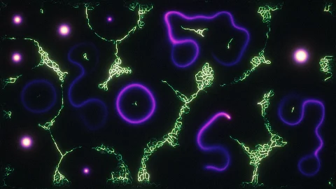
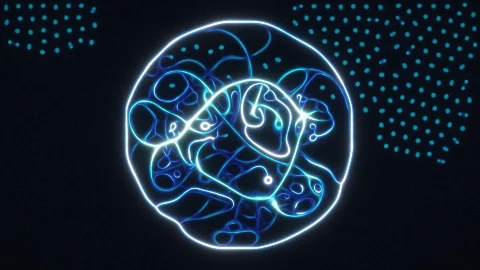
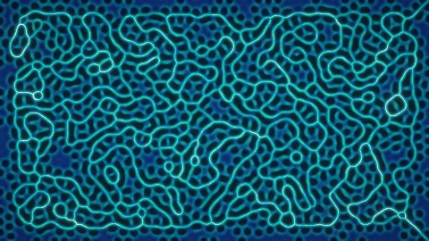
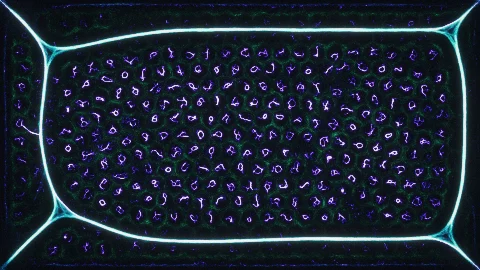

# Digital Life Sandbox

A glowing, evolving slime-mold simulation that runs on the GPU in one self-contained web page. You watch digital organisms form networks, pick the ones you love, and breed them into structures nobody designed.

The goal is **art through emergence**: organic, soft, luminous forms that are discovered rather than drawn. Slime mold is the starting point. The longer-term goal is digital life in general.

<table>
  <tr>
    <td></td>
    <td></td>
    <td></td>
  </tr>
  <tr>
    <td></td>
    <td></td>
    <td></td>
  </tr>
  <tr>
    <td></td>
    <td></td>
    <td></td>
  </tr>
</table>

<em>Organisms grown and bred in the sandbox.</em>

> **New here, or a new Claude session?** Read this file first, then skim [Notes 3](update_notes/Digital%20Life%20Sandbox%20Notes%203.md), [Build Update 2](update_notes/Digital%20Life%20Sandbox%20Build%20Update%202.md), the [Project Notes](update_notes/Digital%20Life%20Sandbox%20Project%20Notes.md) and the [Research Notes](docs/RESEARCH.md). This README says what exists today. The three notes hold the vision and plans, newest first, and the Research Notes explain the science behind the LIFE systems and the Arena. For the look and the story behind it, read [Design](docs/DESIGN.md) and [World](docs/WORLD.md).

## Run it

1. Double-click `digital_life.html`. It needs a recent **Chrome or Edge** with WebGPU.
2. To save, click **SET FOLDER** and choose this project folder. The browser may ask you to allow access again in a later session.

There is nothing to install and no build step. The project was built for a desktop NVIDIA RTX 4070.

## Project files

| Path | What it is |
|---|---|
| `digital_life.html` | The entire app: interface, GPU shaders and logic |
| `README.md` | This guide |
| `update_notes/Digital Life Sandbox Project Notes.md` | The original vision and design document |
| `update_notes/Digital Life Sandbox Build Update 2.md` | Planned changes after the first build. It overrides the Project Notes where they conflict |
| `update_notes/Digital Life Sandbox Notes 3.md` | Ideas after the Arena: an organism library, smarter body detection and random starting structures |
| `saves/` | Saved organisms (`dl-*.json`) and `taste.json` |
| `saves/bodies/` | The grown body of each save (`.dlbody`): every agent, trail, vein and chemical |
| `saves/thumbs/` | Library pictures. They can be regrown if missing |
| `saves/specimens/` | Living bodies kept from the Arena: a description (`.json`), a picture (`.webp`) and their particles and trail (`.dlspec`, gzip) |
| `saves/removed/` | Saves and specimens removed in the Library. Nothing is permanently deleted there |
| `images/`, `videos/` | PNG and MP4 exports |
| `docs/RESEARCH.md` | Papers behind the LIFE systems, how they were adapted, and test results |
| `docs/DESIGN.md` | The design system: dot-matrix lettering, colors, lumen motion, rooms and icons |
| `docs/WORLD.md` | The story of the lab, its rooms and vocabulary, and the ideas it suggests |
| `docs/screenshots/` | Pictures used in this README |

`saves/`, `images/` and `videos/` are personal working folders. They stay on your computer and are not uploaded to GitHub. The app creates what it needs when you choose a folder.

## How to use it

### The three rooms

You work the night shift in a culture lab (the story is in [docs/WORLD.md](docs/WORLD.md)). The room bar at the top of the screen moves between three rooms:

- **MICROSCOPE** holds your slides. **VIEW** switches between them (`B`):
  - **SOLO** shows one organism large. Adjust its sliders live and draw on it.
  - **BATCH** is a tray of nine variants. Click the ones you like, press **BREED**, and repeat. Double-click a tile to open it in Solo from where it currently is.
- **INCUBATOR** (`A`) is the Arena: a round dish of broth where living specimens cut from your organisms eat, divide, mutate and compete. See [The Arena](#the-arena).
- **ARCHIVE** (`L`) is the Library of saves, the family tree and specimens.

The display shows a row of small icons. They light up while something is on and flash in color when it happens, such as breeding, mutating, saving or placing a specimen. A pressed control glows briefly and the glow fades the way the organisms' trails do. Outside the simulation, nothing moves.

Each Batch generation holds your kept picks, guided children, one plain child and one **WILD** child. With **FILTER** on, dead variants are replaced before you see them.

### Pads and shortcuts

| Control | Key | What it does |
|---|---|---|
| MUTATE / BREED / ADD | `M` / `Enter` | Changes the rules. **PASS ON** decides whether the grown body carries over. In Arena, adds a specimen |
| RANDOM | `N` | Rolls unrelated new organisms. Batch keeps picked tiles. Arena grows and places a wild specimen |
| REROLL / EMPTY | `R` | Same settings, fresh start, leaving any inherited body behind. In Arena, press twice to empty it |
| REPLAY | `P` | Same settings and same start. An inherited body returns to its moment of birth. Arena replays its founders |
| SAVE | `S` | Saves the body and rules of the organism, or of every picked tile. Not used in Arena |
| PAUSE | `Space` | Freezes or resumes |
| UNDO | `U`, `Ctrl+Z` | Reverses the last change, brush stroke or generation. In Arena, removes the last founder |
| LIBRARY | `L` | Browse saves as a grid or family tree |
| FULL | `F` | Fullscreen |
| View | `B`, `A` | `B` switches Solo and Batch. `A` opens or leaves the Arena |
| Help | `H` | Hover over anything for an explanation |
| Draw page | `D` | Opens the brushes |
| Export | `I`, `C`, `V` | PNG image, seamless 6-second loop, 1080p recording |
| Speed | `[`, `]` | 1x to 8x |
| Tiles | `1`-`9`, `Shift`+`1`-`9` | Pick a tile, or open it |

### Control pages

The numbered menu under the settings opens one page at a time.

- **ORGANISM:** species count, ecology and movement sliders.
- **LIFE:** optional veins and living cells.
- **FIELD:** an optional reaction-diffusion chemical that agents interact with.
- **LIGHT:** color gradients, glow and exposure. These change the look only.
- **DRAW:** barrier and organism brushes, in Solo.
- **TASTE:** what the app has learned from your picks.

### Drawing

- **BARRIER** paints smooth, thick walls organisms cannot enter. **ERASE** removes them. The current run continues while you draw, then **GROW** starts a new run inside the drawing.
- MUTATE, RANDOM, REROLL, REPLAY and switching to Batch also pick up a new drawing. MUTATE keeps the grown body when barriers are added, so a structure can adapt to a new wall.
- Barriers are one shared world across Solo and Batch. **CLEAR** or **ERASE** reaches every tile and future child. Anything that grew around a removed barrier restarts, because its shape would otherwise remain as a ghost.
- **ORGANISMS: EMPTY** on the DRAW page removes all organisms, keeps the barriers and selects the organism brush. In an empty sandbox, barriers apply immediately. **FILLED** goes back to a normal start. **START: BLANK** is the same empty state.
- Children you breed inherit their parent's barriers. RANDOM keeps the current barriers too. Use **CLEAR**, then **GROW**, to remove them.
- **ORGANISM** places the chosen species wherever you hold or swipe the mouse. It moves existing or parked agents to the brush, so the total pool stays constant and performance is unaffected.
- Painted organisms are recorded by simulation step, so REPLAY and saves re-enact them. REROLL, MUTATE, RANDOM and breeding start without them.

### Inheritance and early life

Every organism has two parts. The **rules** are its settings. The **body** is the grown structure itself: every agent, trail, vein and chemical.

- **PASS ON** sits under MUTATION in the main controls and decides what children receive. **BODY + RULES** (default) starts each child inside its parent's grown body with mutated rules. **RULES ONLY** regrows each child from nothing.
- Every bred Batch tile is labeled **BODY + RULES** or **RULES ONLY** with what it actually received. In Batch, the display's fourth line shows **PASS BODY** or **PASS RULES**, and after BREED it confirms what the generation got.
- A child gets the rules only when there was no body to give, such as an unpainted BLANK sandbox. The tile label and the confirmation say so.
- With two picked parents, the child lives in one parent's body and mixes rules from both.
- **BIOLOGY: VEINS** thickens busy paths and withers unused ones, which helps structure survive new rules.
- **BIOLOGY: CELLS** adds veins plus energy, feeding, division, death and per-cell inherited rules. Followed trails act as food and fled trails as poison.

### Saves and breeding

- **SAVE always stores the body and the rules**, so a save reopens exactly as it looked. Each save uses about 5 to 20 MB. With CELLS on, expect about 7 MB at LOW or from a Batch tile, 27 MB at MED and 49 MB at HIGH.
- **No duplicates.** Saving the same organism again updates its existing entry, keeping its name, tags and family links. "Same organism" means the same seed, start, rules, biology, barriers and painting. Colors don't count.
- Opening the Library folds any older duplicate saves into their newest copy. The kept save takes over their names, tags and family links, and the copies move to `saves/removed/`.
- **Automatic names.** A new save is named from its picture's main colors and its measured shape, such as "Dense Amber-Azure Lace". Repeats get II, III and so on. Unnamed older saves are named when the Library opens. Typing a name replaces it.
- Each Library card shows **BODY + RULES** or **RULES ONLY**. RULES ONLY marks an older save that regrows from settings. Open it and SAVE again to store its body.
- Library **BREED** passes on whatever PASS ON says, so with BODY + RULES the children start inside the saved body.
- In the TREE view, a label like **+2 GEN** on a line is not a copy. It means two generations were bred in between without being saved.
- Removed saves don't appear in the TREE. Their children connect straight to the removed save's own parents, and the +GEN label counts the removed generation.

Breeding never changes a save file. Children are new organisms until you save them.

### The Arena

The two pages are two levels of selection. In Solo and Batch you choose bodies for their structure. In the Arena, specimens of those bodies compete for food, and only the ones that can sustain themselves last.

1. Press **A**, or click **INCUBATOR** in the room bar. The INCUBATOR page replaces the organism pages.
2. Choose what to add on the **ADD FROM** row:
   - **SOLO** puts the organism you last had in Solo on the cutting bench. To use a different organism, open it in Solo first.
   - **LIBRARY** opens the Library. Press **ADD** on any save to put it on the cutting bench, or switch to **SPECIMENS** and press **ADD TO ARENA** to place a kept body directly. A save without a body is regrown out of sight first.
   - **WILD** grows a random organism, cuts its best body (or its densest part if it has none) and places it in the most open spot.
3. **The cutting bench** shows the organism with the bodies found in it outlined, best first, labeled A, B, C. Everything outside the chosen cut is dimmed.
   - Click an outlined body to choose it. A body inside another can be clicked directly.
   - Click anywhere else for a round cut, and scroll to size it. **CIRCLE** sets its starting size.
   - **CUT** (`Enter`, or the ADD pad) takes it. Esc cancels. The Incubator holds still while the bench is open.
4. A ring the size of the cut follows the pointer. Click to place it. Press **ADD** (`M`) for the most open spot, or Esc to cancel.
5. The **WORLD** row:
   - **KEEP** saves a living body as a specimen. Click it, then click a body; everything inside the ring is kept.
   - **REPLAY** places the same founders again and replays the same history.
   - **CLEAR** removes every founder. Press it twice. The EMPTY pad does the same.

**How bodies are found.** Particle density is measured on a 240x135 grid. Dense regions are followed from the tightest threshold to the loosest, and a region that keeps its own identity over several thresholds stands apart from its surroundings: that is a body. Each body is filled in, so a membrane keeps whatever it holds, and ranked by how well it stands apart, how steady it is, whether it encloses space or has a brighter rim, and its size. Trail piled along the frame is ranked down. The cut follows the body's own outline with a small margin, so strands of network passing by stay behind.

**What carries over.** A specimen keeps its particles where they were, the trail and veins beneath them, and each particle's own rules. Living cells keep their inherited multipliers. It is cut at its own scale. Only a body too big for the dish, wider than about 84% of the picture height, is shrunk evenly to fit, and the bench says so. A body keeps its full density unless it would take more than 40% of the world.

**What each particle carries:**

- **Movement rules** from its species, as in Solo.
- **A target density**, imprinted from the density it actually lived at when cut. Vein particles want vein density, and rim particles want rim density. It drifts slowly toward its new surroundings, so a transplanted body can adjust instead of starving.
- **A chemical identity:** how much of each of three shared chemicals it gives off, and how strongly it is drawn to or repelled by each. A founder's responses are solved so its own species still follow and flee each other exactly as in their home world. How it reacts to other founders follows from how alike their chemicals are, and that identity can evolve.
- **Energy.** Particles digest food best near their target density and with kin around, so a loner can barely eat. They divide when full, pass slightly mutated genes to their daughters, and die when starved.

**The world:**

- **Food** regrows like sunlight, and dead particles return to it.
- **Food flows through veins** about five times faster than across open ground, the way *Physarum* streams nutrients through its tubes. A body's vein network drains its territory and feeds its middle.
- **Homing.** A particle that has wandered away, sensing little of its kin where it stands or where its sensors reach, turns back. Swarming bacteria such as *Myxococcus* reverse direction in a similar way to stay with their swarm. Without homing, a wanderer has nothing to steer by, lays a trail others follow, and the body frays into a spreading network.
- **FOOD**, **METABOLISM**, **HOMEOSTASIS** and **GENE DRIFT** shape the competition. HOMEOSTASIS sets how reliably lost particles turn back, how hard crowding pushes out, and how narrowly they digest around their target density. At 0 the Arena behaves like classic slime. From about 0.5, bodies stay separate individuals.

**What you can see:**

- **CHART: BODIES** is an LED display that stacks how many separate bodies each strain has over time, in its chemical color. For life-like behavior, this matters more than size: it shows whether a strain stays as individuals, divides, or merges into one sprawl. **PARTICLES** stacks each strain's share of the world instead.
- **Strains:** each placed specimen founds a strain, which is the specimen and all its descendants. Each row shows the strain's share of the world and its number of bodies. Point at a row to light that strain up in the dish while the others dim. Click one to see:
  - its particles and bodies;
  - its largest and oldest body;
  - divisions, body deaths and typical body lifespan;
  - energy;
  - how each gene has drifted since it was placed: set point, speed, sensor angle and reach, deposit, foraging, and chemistry shown as a color swatch.
  - **KEEP LARGEST BODY** saves that body as a specimen.
- **How bodies are found:** where a lineage is dense on a 96x54 grid, each connected patch is a body. Bodies are followed by overlap between counts, twice a second. One body becoming two counts as a division. The counts are approximate, since a thin bridge that flickers can look like a split.
- Colors show chemical identity. Similar colors can smell each other.

**Specimens.** A kept specimen holds every particle inside the ring, of any lineage, with every gene it evolved, plus the trail and veins beneath. It is saved in `saves/specimens/` and listed in the Library under **SPECIMENS**. Each card shows when it was kept, its average set point, speed and sensors, and which founders its particles came from. Added back to an Arena, its particles keep their own genes and set points.
- The world is round: the largest circle that fits the 1920x1080 picture. Particles, food, trail and placed specimens all stay inside the glass.
- The arena always runs at MED: 1920x1080 and 500,000 particle places. A step costs about 1 ms on the RTX 4070. Up to 16 founders, each thinned to at most 200,000 particles.
- **REPLAY** places the same founders again and reproduces the same history exactly.

The design reasoning, the research behind it and what was measured are in [docs/RESEARCH.md](docs/RESEARCH.md#the-arena).

### The LIFE score

The LIFE score is a rough 0 to 99 measure of life-like structure. Help mode shows its parts when you point at a tile or the display.

- **Version 2** rewards **bodies**, meaning bounded structures that stand apart from their surroundings, and **variety** across the frame. Flow, webs, contrast, shape, balance and motion still count, but less.
- An even texture filling the whole frame now scores about 55.
- Trail hugging the border and straight horizontal and vertical lines are marked down. A frame locked into a grid gets the new **GRID** verdict and is filtered like other dead variants.
- **NOISE** now also requires that no closed structure formed, so jagged crystal lattices are no longer called noise.
- It was checked against saves tagged as scoring too high or too low. All five moved the right way: 99→55, 95→52, 92→19 (GRID), 75→87 and 19→81.
- Older saves keep the score they were saved with.
- In the Library, with Help on (`H`), pointing at a card's LIFE chip shows its parts. Saves from before version 2 lack BODIES and VARIETY, and the card says so.

## How it works

**Simulation.** Each agent senses trail ahead, left and right, steers, moves and deposits. The trail map then blurs and fades. All of this runs in WebGPU compute shaders.

| Quality | Trail map | Agents |
|---|---|---|
| LOW and Batch tiles | 960x540 | 125,000 |
| MED | 1920x1080 | 500,000 |
| HIGH | 2560x1440 | 900,000 |

**Key systems in `digital_life.html`:**

- **Species:** up to 3, stored as index ranges in one agent buffer, with a follow/avoid matrix (RIVAL, ALLY, CHASE, CYCLE).
- **Reaction field:** Gray-Scott on a fixed 480x270 grid (CORAL, MAZE, CELLS, WAVES).
- **Barriers:** smoothed strokes rasterized to a fixed 1920x1080 mask and drawn as vector art with a perforated finish. Agents bounce off, and trail and chemical cannot enter.
- **Organism brush:** timed events stored in the genome and applied between simulation steps. A negative position marks an agent as parked in reserve, which is how BLANK works.
- **Bodies:** full GPU copies of agents, trail, veins, chemical and genes, up to 1.5 GB with the oldest released first. `placeState` moves them between quality levels.
- **Veins:** stored in the trail texture's alpha channel as 1 minus vein strength, so a plain map means no veins.
- **Living cells:** a four-stage compute step of claim, birth, live and clear, with a separate 32-byte gene record per agent. Atomic claims keep runs repeatable.
- **Rendering:** per-species gradient lookup, bloom, ACES tone mapping and fine grain.
- **Metrics:** a GPU probe produces the LIFE score and verdicts ALIVE, NOISE, GRID, BLOB, FLAT or EMPTY. New variants get four checkpoints because good organisms can start slowly. Version 2 adds coarse-scale bodies, block variety, border share and edge direction.
- **Arena:** its own claim, birth, live and clear stages over a 64-byte gene per particle. Steering adds a crowding penalty to slime sensing, which is Particle Lenia's energy. Food is a mass-balanced field that flows faster along veins, and three shared chemical channels carry each lineage's identity. Specimens are held in memory, so REPLAY is exact.
- **Taste learning:** momentum from recent pick direction plus memory of favorites. One plain child and the WILD child are never steered.
- **Family records:** an in-memory graph connects unsaved generations, so a save links to its nearest saved ancestors.
- **Export:** a custom PNG writer, plus WebCodecs H.264 with a custom MP4 muxer.

**Save format (version 7):** `id, parents, generation, name, tags, createdAt, seed, step, quality, init, grownAt, count, species, field, life, view, metrics`, plus these optional fields:

- `walls`, `spawns` and `body`. `body` points to a gzip file in `saves/bodies/`. `spawns` is left out when a body is saved.
- `paint`, a fingerprint of `spawns`.
- `updatedAt`, set when a save is updated.
- `autoName`, set while the name is automatic. Older versions still load. When changing the format, keep them loading.

## Rules for future changes

1. **Protect determinism.** A seed and settings must reproduce a run exactly. Deposits use atomic fixed-point math and each agent has its own random stream. New features must have no effect when unused.
2. **Never test against real saves.** Use copies or browser-private storage (OPFS). Do not modify `saves/`, `images/` or `videos/`.
3. **Keep it one self-contained HTML file** unless there is a deliberate decision to change that.
4. **Keep the interface simple.** It pairs a dot-matrix lab instrument with light that fades like the organisms' trails. Follow [docs/DESIGN.md](docs/DESIGN.md). Too many options is a known concern, so explain new controls in the Help system.
5. **Change one thing at a time** and test it on the GPU.

### Regression check

Open the page through `http://localhost`, then run the five cases below from the browser console. Set each case with the interface controls, assign `DL.st.seed` and `DL.st.init`, then call `DL.restart()`, `await DL.advance(400)` and `await DL.hash()`.

| Quality | Seed | Start | Species | Ecology | Hybrid | Expected hash |
|---|---|---|---|---|---|---|
| MED | 12345 | scatter | 1 | none | off | `678BF9A8` |
| LOW | 777 | in | 2 | chase | off | `F6A141F8` |
| HIGH | 9001 | out | 3 | cycle | off | `8E45D7FF` |
| LOW | 5150 | scatter | 2 | rival | coral | `96ADE82B` |
| MED | 6060 | out | 3 | cycle | cells | `573B3DF1` |

A changed hash means the simulation's behavior changed. That is only acceptable when the change is intended. `window.DL` is the debug handle for this kind of testing.

## Known limitations

- Older RULES ONLY saves regrow at most 3,000 steps when reopened. Saving them again stores their body.
- A browser without folder access can only download the rules.
- After a save is reopened, REPLAY returns to the saved moment rather than the organism's birth.
- A body file is compressed with very slightly rounded trail values. Agents, genes and chemical are exact.
- Automatic names are simple word choices from color and measurements, so similar organisms can get similar names.
- Undo and old generations may fall back to their recipe once the 1.5 GB body memory fills.
- A child inherits one parent's body. In the Arena, separate bodies share a world, but they never fuse into one organism.
- Arena membranes are rings of particles held by density preferences. Their wall is not built from a material the cell makes itself.
- In the Arena, whole bodies have not yet been seen dividing into two. Runs of 3,000 to 4,000 steps showed coexistence, spreading networks, persistent rings and lineages invading each other.
- An Arena's founders and history are lost when the page closes. KEEP saves living bodies as specimens, and images and clips keep the look.
- Body counts, divisions and deaths in the Arena are measured on a coarse grid, so they are approximate.
- The cutting bench finds bodies from particle density on a grid of 8-pixel cells (4 pixels on a Batch tile), so outlines are stepped, and a faint body in a dense network can be missed. A round cut is always available.
- Cuts from the cutting bench are not saved yet. KEEP in the Incubator still saves living bodies as specimens.
- A body shaped by a reaction-diffusion field loses that field in the Arena, so it reorganizes after placing.
- There is no WebGL2 fallback.
- A hidden browser tab or preview pane throttles animation, so frame-rate measurements there are not meaningful.

## Status and roadmap

**Built:** WebGPU simulation, Solo and Batch, breeding, 3 species, ecologies, reaction-diffusion hybrids, 12 color gradients, metrics and dead-variant filter, Help mode, taste learning, PNG and MP4 export, visual Library, family tree, RANDOM, barrier brush, organism brush, BLANK start, inherited bodies, full-body saves with automatic names and no duplicates, veins, living cells with energy, division, death and per-cell inherited rules, the Arena, LIFE score version 2, and the lab look with three rooms, a round Incubator and flashing display icons.

**Build Update 2 progress:**

1. Done: children inherit the grown structure.
2. Done: full-state saves. Every save now keeps the body.
3. Done: per-agent inherited parameters, through CELLS and the Arena.
4. Done in the Arena: several saved structures share one world. Fusing two into one organism is not built.
5. Done in the Arena: a finite food source with recycled matter. Solo CELLS still feed on trail.
6. Not started: endosymbiosis-inspired dependence. The Arena's shared chemistry is where it could grow.

**Arena next steps:**

1. Save and reopen a whole Arena, with its founders and history.
2. Membrane material made by the particles themselves.
3. Score lineages by their bodies: how long they last and how often they divide.

**Other ideas from the Project Notes:** first-run preset gallery, parameter locks for RANDOM, a replay timeline with scrubbing, mutating only part of a body, and small evolvable brains.
