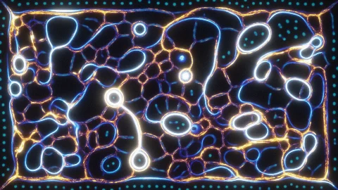
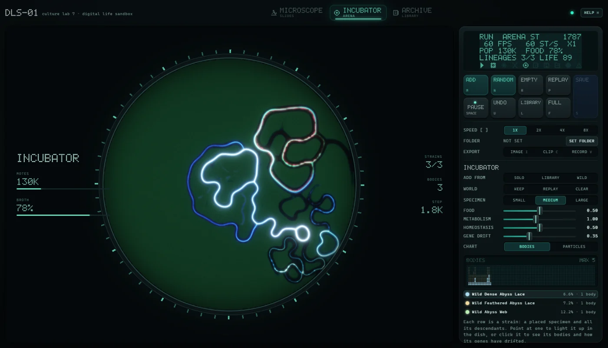
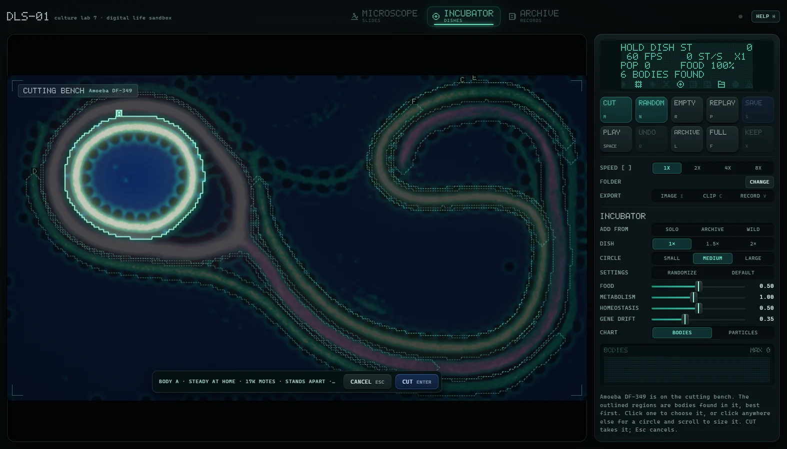
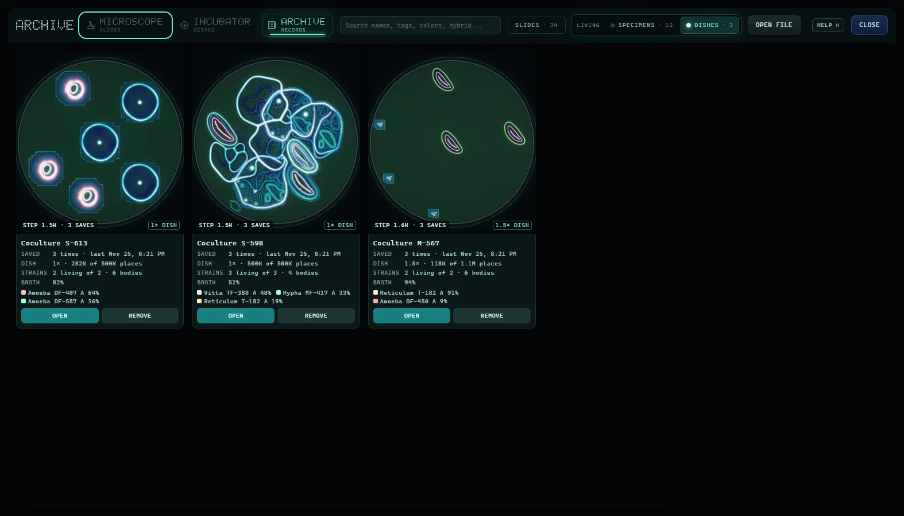

# Digital Life Sandbox

A GPU slime-mold lab in one self-contained web page. Grow and breed glowing organisms in the Microscope, cut living
bodies out of them as specimens, and watch those specimens eat, divide, mutate and compete in a dish in the Incubator.
Everything you grow, cut or keep is filed in the Archive.

The goal is **art through emergence**: organic, soft, luminous forms that are discovered rather than drawn, and digital
life that holds together as individuals.

<table>
  <tr>
    <td></td>
    <td></td>
    <td></td>
  </tr>
  <tr>
    <td></td>
    <td></td>
    <td></td>
  </tr>
  <tr>
    <td></td>
    <td></td>
    <td></td>
  </tr>
</table>

<em>Organisms grown and bred in the sandbox.</em>

## The lab

<table>
  <tr>
    <td></td>
    <td></td>
    <td></td>
  </tr>
  <tr>
    <td align="center"><em>Cutting a body</em></td>
    <td align="center"><em>A square body in Consortium L-743</em></td>
    <td align="center"><em>Saved dishes in the Archive</em></td>
  </tr>
</table>

<em>Cells found in Consortium L-848: each box has a name and score, and green marks a cell with a body inside at 80% or more</em>

You work the night shift in a culture lab. Three rooms:

- **MICROSCOPE.** Slides of slime-mold organisms: one large (SOLO) or a tray of nine to breed from (BATCH). Pick the
  ones you love, breed them, draw on them, and CUT a body out of anything on screen.
- **INCUBATOR** (`A`). A round dish of broth where specimens live together: each brings its own chemistry and reaction
  field, eats, divides and evolves, and is held at about its own size. Dishes come in three sizes, zoom and pan, and can
  be saved whole. CELLS boxes the cell-like structures that form there and scores them; KEEP CELL files one.
- **ARCHIVE** (`L`). Your saved slides, as a grid or a family tree, and the LIVING things: specimens and saved dishes,
  each dish with a snapshot from every save.

Everything alive is named like a lab strain, such as "Reticulum T-182". Press `H` anywhere for help on any control.

## Run it

1. Double-click `digital_life.html`. It needs a recent **Chrome or Edge** with WebGPU.
2. To save, click **SET FOLDER** and choose this project folder.

There is nothing to install and no build step. It was built on a desktop NVIDIA RTX 4070.

## Read more

| Where | What |
|---|---|
| [docs/GUIDE.md](docs/GUIDE.md) | How to use it: every room, control and shortcut |
| [docs/ARCHITECTURE.md](docs/ARCHITECTURE.md) | How it works inside, file formats, the rules for changing it, and the tests |
| [docs/RESEARCH.md](docs/RESEARCH.md) | The science behind it, how it was adapted, and everything measured |
| [docs/DESIGN.md](docs/DESIGN.md) | The design system: dot-matrix lettering, lumen colors, rooms and icons |
| [docs/WORLD.md](docs/WORLD.md) | The story of the lab and its vocabulary |
| [CHANGELOG.md](CHANGELOG.md) | What changed, newest first |
| `tests/` | The test suite: `.\tests\run.ps1` |
| `update_notes/` | The original vision and earlier plans, kept as history |

> **New here, or a new Claude session?** Read this page, then [ARCHITECTURE.md](docs/ARCHITECTURE.md) (its rules and
> glossary first), then the newest entries in [CHANGELOG.md](CHANGELOG.md) and [RESEARCH.md](docs/RESEARCH.md). Run
> `.\tests\run.ps1` before and after any change.

`saves/`, `images/` and `videos/` are personal working folders. They stay on your computer and are not uploaded.

## Status

**Built:** the Microscope (breeding, three species, ecologies, reaction-diffusion hybrids, inherited bodies, living
cells, barriers, an organism brush, taste learning, the LIFE score), the cutting bench, specimens and the deck, the
Incubator (six chemicals, food that flows along veins, energy only from food, drifting patches of food and two kinds of
food with a diet gene, strains that win or lose ground, carried reaction fields, three dish sizes, zoom, saved dishes,
framed recordings, a cell finder, an ecosystem score), and the Archive (slides, family tree, specimens with a tested BEHAVIOR line, dishes with snapshots),
with PNG and MP4 export and Help everywhere.

**Next:**

1. Cohesion that can evolve (homing and crowding as genes), so bodies last because selection favours strains that hold
   together ([research](docs/RESEARCH.md#why-dishes-turned-to-mush)).
2. Membrane material made by the particles themselves, and whole bodies that divide.

Every idea, with what it is for, its size and whether it is done, is kept in [IDEAS.md](docs/IDEAS.md).
