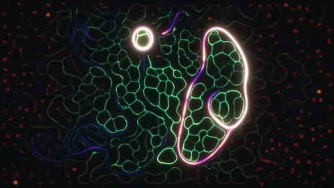
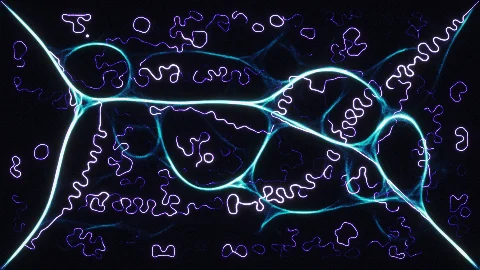

# Digital Life Sandbox

A glowing, evolving slime-mold simulation that runs on the GPU in one self-contained web page. You watch digital organisms form networks, pick the ones you love, and breed them into structures nobody designed.

The goal is **art through emergence**: organic, soft, luminous forms that are discovered rather than drawn. Slime mold is the starting point. The longer-term goal is digital life in general.

<table>
  <tr>
    <td></td>
    <td></td>
    <td></td>
  </tr>
  <tr>
    <td></td>
    <td></td>
    <td></td>
  </tr>
  <tr>
    <td></td>
    <td></td>
    <td></td>
  </tr>
</table>

<em>Organisms grown and bred in the sandbox.</em>

> **New here, or a new Claude session?** Read this file first, then skim [Build Update 2](Digital%20Life%20Sandbox%20Build%20Update%202.md), the [Project Notes](Digital%20Life%20Sandbox%20Project%20Notes.md) and the [Research Notes](docs/RESEARCH.md). This README says what exists today. The first two hold the vision and plan, and the last explains the science behind the LIFE systems.

## Run it

1. Double-click `digital_life.html`. It needs a recent **Chrome or Edge** with WebGPU.
2. To save, click **SET FOLDER** and choose this project folder. The browser may ask you to allow access again in a later session.

There is nothing to install and no build step. The project was built for a desktop NVIDIA RTX 4070.

## Project files

| Path | What it is |
|---|---|
| `digital_life.html` | The entire app: interface, GPU shaders and logic |
| `README.md` | This guide |
| `Digital Life Sandbox Project Notes.md` | The original vision and design document |
| `Digital Life Sandbox Build Update 2.md` | The next planned changes. It overrides the Project Notes where they conflict |
| `saves/` | Saved organisms (`dl-*.json`) and `taste.json` |
| `saves/bodies/` | The grown body of each save (`.dlbody`): every agent, trail, vein and chemical |
| `saves/thumbs/` | Library pictures. They can be regrown if missing |
| `saves/removed/` | Saves removed in the Library. Nothing is permanently deleted there |
| `images/`, `videos/` | PNG and MP4 exports |
| `docs/RESEARCH.md` | Papers behind the LIFE systems, how they were adapted, and test results |
| `docs/screenshots/` | Pictures used in this README |

`saves/`, `images/` and `videos/` are personal working folders. They stay on your computer and are not uploaded to GitHub. The app creates what it needs when you choose a folder.

## How to use it

### The two views

- **SOLO** shows one organism large. Adjust its sliders live and draw on it.
- **BATCH** shows nine variants. Click the ones you like, press **BREED**, and repeat. Double-click a tile to open it in Solo from where it currently is.

Each Batch generation holds your kept picks, guided children, one plain child and one **WILD** child. With **FILTER** on, dead variants are replaced before you see them.

### Pads and shortcuts

| Control | Key | What it does |
|---|---|---|
| MUTATE / BREED | `M` / `Enter` | Changes the rules. **PASS ON** decides whether the grown body carries over |
| RANDOM | `N` | Rolls unrelated new organisms. Batch keeps picked tiles |
| REROLL | `R` | Same settings, fresh start, leaving any inherited body behind |
| REPLAY | `P` | Same settings and same start. An inherited body returns to its moment of birth |
| SAVE | `S` | Saves the body and rules of the organism, or of every picked tile |
| PAUSE | `Space` | Freezes or resumes |
| UNDO | `U`, `Ctrl+Z` | Reverses the last change, brush stroke or generation |
| LIBRARY | `L` | Browse saves as a grid or family tree |
| FULL | `F` | Fullscreen |
| View | `B` | Switches Solo and Batch |
| Help | `H` | Hover over anything for an explanation |
| Draw page | `D` | Opens the brushes |
| Export | `I`, `C`, `V` | PNG image, seamless 6-second loop, 1080p recording |
| Speed | `[`, `]` | 1x to 8x |
| Tiles | `1`-`9`, `Shift`+`1`-`9` | Pick a tile, or open it |

### Control pages

- **ORGANISM:** species count, ecology and movement sliders.
- **LIFE:** optional veins and living cells.
- **FIELD:** an optional reaction-diffusion chemical that agents interact with.
- **LIGHT:** color gradients, glow and exposure. These change the look only.
- **DRAW:** barrier and organism brushes, in Solo.
- **TASTE:** what the app has learned from your picks.

### Drawing

- **BARRIER** paints smooth, thick walls organisms cannot enter. **ERASE** removes them. The current run continues while you draw, then **GROW** starts a new run inside the drawing.
- MUTATE, RANDOM, REROLL, REPLAY and switching to Batch also pick up a new drawing. MUTATE keeps the grown body when barriers are added, so a structure can adapt to a new wall.
- Barriers are one shared world across Solo and Batch. **CLEAR** or **ERASE** reaches every tile and future child. Anything that grew around a removed barrier restarts, because its shape would otherwise remain as a ghost.
- **ORGANISMS: EMPTY** on the DRAW page removes all organisms, keeps the barriers and selects the organism brush. In an empty sandbox, barriers apply immediately. **FILLED** goes back to a normal start. **START: BLANK** is the same empty state.
- Children you breed inherit their parent's barriers. RANDOM keeps the current barriers too. Use **CLEAR**, then **GROW**, to remove them.
- **ORGANISM** places the chosen species wherever you hold or swipe the mouse. It moves existing or parked agents to the brush, so the total pool stays constant and performance is unaffected.
- Painted organisms are recorded by simulation step, so REPLAY and saves re-enact them. REROLL, MUTATE, RANDOM and breeding start without them.

### Inheritance and early life

Every organism has two parts. The **rules** are its settings. The **body** is the grown structure itself: every agent, trail, vein and chemical.

- **PASS ON** sits under MUTATION in the main controls and decides what children receive. **BODY + RULES** (default) starts each child inside its parent's grown body with mutated rules. **RULES ONLY** regrows each child from nothing.
- Every bred Batch tile is labeled **BODY + RULES** or **RULES ONLY** with what it actually received. In Batch, the display's fourth line shows **PASS BODY** or **PASS RULES**, and after BREED it confirms what the generation got.
- A child gets the rules only when there was no body to give, such as an unpainted BLANK sandbox. The tile label and the confirmation say so.
- With two picked parents, the child lives in one parent's body and mixes rules from both.
- **BIOLOGY: VEINS** thickens busy paths and withers unused ones, which helps structure survive new rules.
- **BIOLOGY: CELLS** adds veins plus energy, feeding, division, death and per-cell inherited rules. Followed trails act as food and fled trails as poison.

### Saves and breeding

- **SAVE always stores the body and the rules**, so a save reopens exactly as it looked. Each save uses about 5 to 20 MB. With CELLS on, expect about 7 MB at LOW or from a Batch tile, 27 MB at MED and 49 MB at HIGH.
- **No duplicates.** Saving the same organism again updates its existing entry, keeping its name, tags and family links. "Same organism" means the same seed, start, rules, biology, barriers and painting. Colors don't count.
- Opening the Library folds any older duplicate saves into their newest copy. The kept save takes over their names, tags and family links, and the copies move to `saves/removed/`.
- **Automatic names.** A new save is named from its picture's main colors and its measured shape, such as "Dense Amber-Azure Lace". Repeats get II, III and so on. Unnamed older saves are named when the Library opens. Typing a name replaces it.
- Each Library card shows **BODY + RULES** or **RULES ONLY**. RULES ONLY marks an older save that regrows from settings. Open it and SAVE again to store its body.
- Library **BREED** passes on whatever PASS ON says, so with BODY + RULES the children start inside the saved body.
- In the TREE view, a label like **+2 GEN** on a line is not a copy. It means two generations were bred in between without being saved.

Breeding never changes a save file. Children are new organisms until you save them.

## How it works

**Simulation.** Each agent senses trail ahead, left and right, steers, moves and deposits. The trail map then blurs and fades. All of this runs in WebGPU compute shaders.

| Quality | Trail map | Agents |
|---|---|---|
| LOW and Batch tiles | 960x540 | 125,000 |
| MED | 1920x1080 | 500,000 |
| HIGH | 2560x1440 | 900,000 |

**Key systems in `digital_life.html`:**

- **Species:** up to 3, stored as index ranges in one agent buffer, with a follow/avoid matrix (RIVAL, ALLY, CHASE, CYCLE).
- **Reaction field:** Gray-Scott on a fixed 480x270 grid (CORAL, MAZE, CELLS, WAVES).
- **Barriers:** smoothed strokes rasterized to a fixed 1920x1080 mask and drawn as vector art with a perforated finish. Agents bounce off, and trail and chemical cannot enter.
- **Organism brush:** timed events stored in the genome and applied between simulation steps. A negative position marks an agent as parked in reserve, which is how BLANK works.
- **Bodies:** full GPU copies of agents, trail, veins, chemical and genes, up to 1.5 GB with the oldest released first. `placeState` moves them between quality levels.
- **Veins:** stored in the trail texture's alpha channel as 1 minus vein strength, so a plain map means no veins.
- **Living cells:** a four-stage compute step of claim, birth, live and clear, with a separate 32-byte gene record per agent. Atomic claims keep runs repeatable.
- **Rendering:** per-species gradient lookup, bloom, ACES tone mapping and fine grain.
- **Metrics:** a GPU probe produces the LIFE score and verdicts ALIVE, NOISE, BLOB, FLAT or EMPTY. New variants get four checkpoints because good organisms can start slowly.
- **Taste learning:** momentum from recent pick direction plus memory of favorites. One plain child and the WILD child are never steered.
- **Family records:** an in-memory graph connects unsaved generations, so a save links to its nearest saved ancestors.
- **Export:** a custom PNG writer, plus WebCodecs H.264 with a custom MP4 muxer.

**Save format (version 7):** `id, parents, generation, name, tags, createdAt, seed, step, quality, init, grownAt, count, species, field, life, view, metrics`, plus these optional fields:

- `walls`, `spawns` and `body`. `body` points to a gzip file in `saves/bodies/`. `spawns` is left out when a body is saved.
- `paint`, a fingerprint of `spawns`.
- `updatedAt`, set when a save is updated.
- `autoName`, set while the name is automatic. Older versions still load. When changing the format, keep them loading.

## Rules for future changes

1. **Protect determinism.** A seed and settings must reproduce a run exactly. Deposits use atomic fixed-point math and each agent has its own random stream. New features must have no effect when unused.
2. **Never test against real saves.** Use copies or browser-private storage (OPFS). Do not modify `saves/`, `images/` or `videos/`.
3. **Keep it one self-contained HTML file** unless there is a deliberate decision to change that.
4. **Keep the interface simple.** It follows a tactile, EP-133-inspired hardware style with a calm blue-green palette. Too many options is a known concern, so explain new controls in the Help system.
5. **Change one thing at a time** and test it on the GPU.

### Regression check

Open the page through `http://localhost`, then run the five cases below from the browser console. Set each case with the interface controls, assign `DL.st.seed` and `DL.st.init`, then call `DL.restart()`, `await DL.advance(400)` and `await DL.hash()`.

| Quality | Seed | Start | Species | Ecology | Hybrid | Expected hash |
|---|---|---|---|---|---|---|
| MED | 12345 | scatter | 1 | none | off | `678BF9A8` |
| LOW | 777 | in | 2 | chase | off | `F6A141F8` |
| HIGH | 9001 | out | 3 | cycle | off | `8E45D7FF` |
| LOW | 5150 | scatter | 2 | rival | coral | `96ADE82B` |
| MED | 6060 | out | 3 | cycle | cells | `573B3DF1` |

A changed hash means the simulation's behavior changed. That is only acceptable when the change is intended. `window.DL` is the debug handle for this kind of testing.

## Known limitations

- Older RULES ONLY saves regrow at most 3,000 steps when reopened. Saving them again stores their body.
- A browser without folder access can only download the rules.
- After a save is reopened, REPLAY returns to the saved moment rather than the organism's birth.
- A body file is compressed with very slightly rounded trail values. Agents, genes and chemical are exact.
- Automatic names are simple word choices from color and measurements, so similar organisms can get similar names.
- Undo and old generations may fall back to their recipe once the 1.5 GB body memory fills.
- A child inherits one parent's body. Merging two bodies is not built yet.
- Cells have no true self-made membrane yet, and evidence of in-world selection is still small.
- There is no WebGL2 fallback.
- A hidden browser tab or preview pane throttles animation, so frame-rate measurements there are not meaningful.

## Status and roadmap

**Built:** WebGPU simulation, Solo and Batch, breeding, 3 species, ecologies, reaction-diffusion hybrids, 12 color gradients, metrics and dead-variant filter, Help mode, taste learning, PNG and MP4 export, visual Library, family tree, RANDOM, barrier brush, organism brush, BLANK start, inherited bodies, full-body saves with automatic names and no duplicates, veins, and living cells with energy, division, death and per-cell inherited rules.

**Build Update 2 progress:**

1. Done: children inherit the grown structure.
2. Done: full-state saves. Every save now keeps the body.
3. Done: per-agent inherited parameters, through CELLS.
4. **Next:** merge two saved structures into one world.
5. Partly done: energy and a food web from the FOLLOW matrix. Separate food sources are not built.
6. Not started: endosymbiosis-inspired dependence.

**Other ideas from the Project Notes:** first-run preset gallery, parameter locks for RANDOM, a replay timeline with scrubbing, mutating only part of a body, and small evolvable brains.
