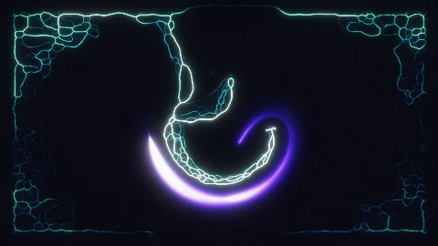
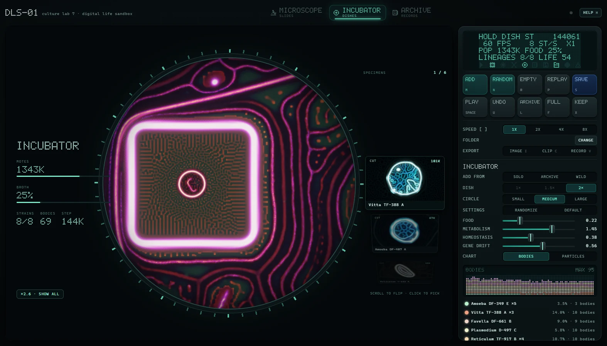

# Digital Life Sandbox

A GPU slime-mold lab in one self-contained web page. Grow and breed glowing organisms in the Microscope, cut living
bodies out of them as specimens, and watch those specimens eat, divide, mutate and compete in a dish in the Incubator.
Everything you grow, cut or keep is filed in the Archive.

The goal is **art through emergence**: organic, soft, luminous forms that are discovered rather than drawn, and digital
life that holds together as individuals.

<table>
  <tr>
    <td></td>
    <td></td>
    <td></td>
  </tr>
  <tr>
    <td></td>
    <td></td>
    <td></td>
  </tr>
  <tr>
    <td></td>
    <td></td>
    <td></td>
  </tr>
</table>

<em>Organisms grown and bred in the sandbox.</em>

## The lab

<table>
  <tr>
    <td></td>
    <td></td>
    <td></td>
  </tr>
  <tr>
    <td align="center"><em>Cutting a body</em></td>
    <td align="center"><em>A square body in Consortium L-743</em></td>
    <td align="center"><em>Saved dishes in the Archive</em></td>
  </tr>
</table>

<em>Cells found in Consortium L-848: each box has a name and score, and green marks a cell with a body inside at 80% or more</em>

You work the night shift in a culture lab. Three rooms:

- **MICROSCOPE.** Slides of slime-mold organisms: one large (SOLO) or a tray of nine to breed from (BATCH). Pick the
  ones you love, breed them, draw on them, and CUT a body out of anything on screen. BIOLOGY: FED grows them on a real
  broth, so what you breed can live on food.
- **INCUBATOR** (`A`). A round dish of broth where specimens live together: each brings its own chemistry and reaction
  field, eats, divides and evolves, and grows as far as its food allows. Dishes come in three sizes, zoom and pan, and
  can be saved whole. CELLS boxes the cell-like structures that form there and scores them; KEEP CELL files one.
- **ARCHIVE** (`L`). Your saved slides, as a grid or a family tree, and the LIVING things: specimens and saved dishes,
  each dish with a snapshot from every save.

Everything alive is named like a lab strain, such as "Reticulum T-182". Press `H` anywhere for help on any control.

## The approach: grow, cut, stress-test

Most particle-life systems start from a rule set and watch what forms. Here, life-like bodies are bred, harvested and
put to the test, the way a lab works with real organisms:

1. **Grow.** Organisms evolve in the Microscope, bred by your picks (and a taste it learns from them) over generations.
   On BIOLOGY: FED they grow on a real broth, so what you breed can also live on food.
2. **Cut.** A living body is cut out of a slide with every particle inside it. Each particle keeps its own copy of the
   rules, as in Flow-Lenia, and a density **set point imprinted from where it lived in the body**, so the specimen
   carries its own structure with it.
3. **Stress-test, passing genes on.** Specimens are moved into a shared dish with finite food that is never made from
   nothing, rival strains and, if you choose, moving food and predators. Every particle must feed, hold together with
   its kin and divide, passing mutated genes (its rules, set point, homing, crowding, diet, hunting) to its daughters.
   Bodies that cannot sustain themselves die back; the ones that last are what selection keeps.
4. **Measure honestly.** The dish finds cell-like structures and scores them, judges itself as an ecosystem, and counts
   a division only when a body really becomes two that both live on. Failures are kept with the successes.

Likely new, as far as we know (no literature search was done): cutting evolved slime bodies into specimens with
imprinted set points, treating slime agents as Particle Lenia particles with a memory field, and giving each species a
chemical identity that keeps its own relations ([what is new, honestly](docs/RESEARCH.md#what-is-new-here-honestly)).

## Milestones

The goal is digital life that holds together as individuals. Where it stands:

| Milestone | Status | Where it stands |
|---|---|---|
| Organisms that grow bodies, not just patterns | **Done** | Slime molds of up to three species, with veins, reaction fields and living cells, bred in the Microscope |
| Specimens cut from living bodies | **Done** | Every particle keeps its own rules and a set point imprinted from its body |
| Energy only from food | **Done** | Food is the dish's only energy, and a test checks that none is made from nothing |
| Individuals rather than mush | **Done** | Digestion needs kin around, and holding together is an inherited gene |
| Competition, coexistence and predators | **Done** | Strains trade ground; patchy food, two foods and hunting are optional challenges |
| Cell-like structures that form on their own | **Done** | Membranes enclosing bodies form in dishes; the cell finder boxes and scores them |
| Specimens bred to live on food | **Done** | BIOLOGY: FED; across 34 slides, fed cuts typically kept their size where saved ones lost two thirds |
| Real divisions told from look-alikes | **Done** | Bridges, walls, specks and bodies that touch and part are not counted |
| Homeostasis: an inside the cell maintains | Not yet | Bodies' middles hold less food than the broth, and a membrane prototype did not change that |
| Whole bodies that divide | Not yet | None so far: cores split, but bodies never part ([the search for division](docs/DIVISION.md)) |
| Membrane material made by the particles | Not yet | Today's rims are dense particles and their trails, not a material they make |
| Cell types (a rim and a core with different jobs) | Not yet | Planned as two modes per particle |
| Open-ended evolution over long runs | Not yet | Strains drift and compete, but new kinds of body have not appeared |

## Run it

1. Double-click `digital_life.html`. It needs a recent **Chrome or Edge** with WebGPU.
2. To save, click **SET FOLDER** and choose this project folder.

There is nothing to install and no build step. It was built on a desktop NVIDIA RTX 4070.

## Read more

| Where | What |
|---|---|
| [docs/GUIDE.md](docs/GUIDE.md) | How to use it: every room, control and shortcut |
| [docs/ARCHITECTURE.md](docs/ARCHITECTURE.md) | How it works inside, file formats, the rules for changing it, and the tests |
| [docs/RESEARCH.md](docs/RESEARCH.md) | The science behind it, how it was adapted, and everything measured |
| [docs/DIVISION.md](docs/DIVISION.md) | The search for division: every attempt, with pictures, and what it taught |
| [docs/DESIGN.md](docs/DESIGN.md) | The design system: dot-matrix lettering, lumen colors, rooms and icons |
| [docs/WORLD.md](docs/WORLD.md) | The story of the lab and its vocabulary |
| [CHANGELOG.md](CHANGELOG.md) | What changed, newest first |
| `tests/` | The test suite: `.\tests\run.ps1` |
| `update_notes/` | The original vision and earlier plans, kept as history |

> **New here, or a new Claude session?** Read this page, then [ARCHITECTURE.md](docs/ARCHITECTURE.md) (its rules and
> glossary first), then the newest entries in [CHANGELOG.md](CHANGELOG.md) and [RESEARCH.md](docs/RESEARCH.md). Run
> `.\tests\run.ps1` before and after any change.

`saves/`, `images/` and `videos/` are personal working folders. They stay on your computer and are not uploaded.

## Status

**Built:** the Microscope (breeding, three species, ecologies, reaction-diffusion hybrids, inherited bodies, living
cells, barriers, an organism brush, taste learning, the LIFE score), the cutting bench, specimens and the deck, the
Incubator (six chemicals, food that flows along veins, energy only from food, drifting patches of food and two kinds of
food with a diet gene, inherited homing and crowding, predators, strains that win or lose ground, carried reaction fields, three dish sizes, zoom, saved dishes,
framed recordings, a cell finder, an ecosystem score, real divisions only), BIOLOGY: FED in the Microscope, and the Archive (slides, family tree, specimens with a tested BEHAVIOR line, dishes with snapshots),
with PNG and MP4 export and Help everywhere.

**Next:**

1. A body that loosens as it grows, so a body with two cores can part ([the search for division](docs/DIVISION.md)).
2. Breeding on FED across generations, so selection can favor whatever divides.
3. Membrane material made by the particles themselves.

Every idea, with what it is for, its size and whether it is done, is kept in [IDEAS.md](docs/IDEAS.md).
