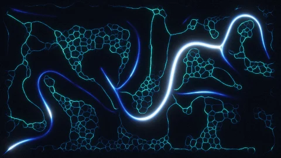
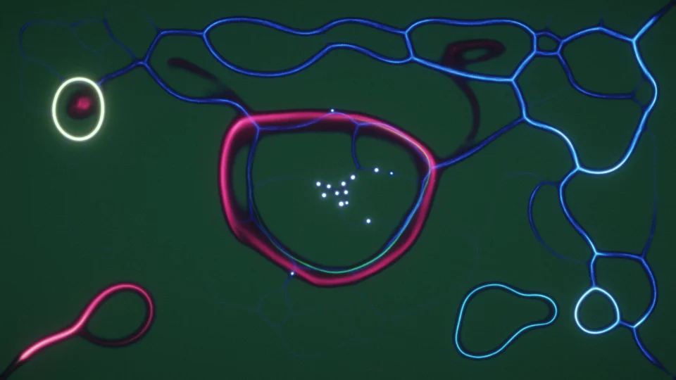

# Digital Life Sandbox

A glowing, evolving slime-mold simulation that runs on the GPU in one self-contained web page. You watch digital organisms form networks, pick the ones you love, and breed them into structures nobody designed.

The goal is **art through emergence**: organic, soft, luminous forms that are discovered rather than drawn. Slime mold is the starting point. The longer-term goal is digital life in general.

<table>
  <tr>
    <td></td>
    <td></td>
    <td></td>
  </tr>
  <tr>
    <td></td>
    <td></td>
    <td></td>
  </tr>
  <tr>
    <td></td>
    <td></td>
    <td></td>
  </tr>
</table>

<em>Organisms grown and bred in the sandbox.</em>

> **New here, or a new Claude session?** Read this file first, then skim [Notes 3](update_notes/Digital%20Life%20Sandbox%20Notes%203.md), [Build Update 2](update_notes/Digital%20Life%20Sandbox%20Build%20Update%202.md), the [Project Notes](update_notes/Digital%20Life%20Sandbox%20Project%20Notes.md) and the [Research Notes](docs/RESEARCH.md). This README says what exists today. The three notes hold the vision and plans, newest first, and the Research Notes explain the science behind the LIFE systems and the Arena. For the look and the story behind it, read [Design](docs/DESIGN.md) and [World](docs/WORLD.md).

## Run it

1. Double-click `digital_life.html`. It needs a recent **Chrome or Edge** with WebGPU.
2. To save, click **SET FOLDER** and choose this project folder. The browser may ask you to allow access again in a later session.

There is nothing to install and no build step. The project was built for a desktop NVIDIA RTX 4070.

## Project files

| Path | What it is |
|---|---|
| `digital_life.html` | The entire app: interface, GPU shaders and logic |
| `README.md` | This guide |
| `update_notes/Digital Life Sandbox Project Notes.md` | The original vision and design document |
| `update_notes/Digital Life Sandbox Build Update 2.md` | Planned changes after the first build. It overrides the Project Notes where they conflict |
| `update_notes/Digital Life Sandbox Notes 3.md` | Ideas after the Arena: an organism library, smarter body detection and random starting structures |
| `saves/` | Saved organisms (`dl-*.json`) and `taste.json` |
| `saves/bodies/` | The grown body of each save (`.dlbody`): every agent, trail, vein and chemical |
| `saves/thumbs/` | Library pictures. They can be regrown if missing |
| `saves/specimens/` | Specimens cut from slides or kept from the Incubator: a description (`.json`), a picture (`.webp`) and their particles and trail (`.dlspec`, gzip). Version 3 files hold all six of the dish's chemicals, a cut's own colors and, for a body that lived in a reaction field, the field beneath it; older files still open |
| `saves/removed/` | Saves and specimens removed in the Library. Nothing is permanently deleted there |
| `images/`, `videos/` | PNG and MP4 exports |
| `docs/RESEARCH.md` | Papers behind the LIFE systems, how they were adapted, and test results |
| `docs/DESIGN.md` | The design system: dot-matrix lettering, colors, lumen motion, rooms and icons |
| `docs/WORLD.md` | The story of the lab, its rooms and vocabulary, and the ideas it suggests |
| `docs/screenshots/` | Pictures used in this README |

`saves/`, `images/` and `videos/` are personal working folders. They stay on your computer and are not uploaded to GitHub. The app creates what it needs when you choose a folder.

## How to use it

### The three rooms

You work the night shift in a culture lab (the story is in [docs/WORLD.md](docs/WORLD.md)). The room bar at the top of the screen moves between three rooms:

- **MICROSCOPE** holds your slides. **VIEW** switches between them (`B`):
  - **SOLO** shows one organism large. Adjust its sliders live and draw on it.
  - **BATCH** is a tray of nine variants. Click the ones you like, press **BREED**, and repeat. Double-click a tile to open it in Solo from where it currently is.
  - **CUT** (`X`) puts whatever is on screen on the cutting bench in the Incubator, however it got there: the Solo organism, or in Batch the slide under the pointer or the last one picked. Each slide also shows **CUT** and **OPEN** buttons when you point at it. Going back to the Microscope returns you to the view you left.
- **INCUBATOR** (`A`) is the Arena: a round dish of broth where living specimens cut from your organisms eat, divide, mutate and compete. See [The Arena](#the-arena).
- **ARCHIVE** (`L`) is the Library. **SLIDES** holds the organisms you saved from the Microscope, to explore and breed, shown as a **GRID** of cards or as their family **TREE**; it opens on the grid. The **LIVING** keys, each with a status light, hold what lives in the Incubator: **SPECIMENS** and saved **DISHES**.

The display shows a row of small icons. They light up while something is on and flash in color when it happens, such as breeding, mutating, saving or placing a specimen. A pressed control glows briefly and the glow fades the way the organisms' trails do. Outside the simulation, nothing moves.

Each Batch generation holds your kept picks, guided children, one plain child and one **WILD** child. With **FILTER** on, dead variants are replaced before you see them.

### Pads and shortcuts

| Control | Key | What it does |
|---|---|---|
| MUTATE / BREED / ADD | `M` / `Enter` | Changes the rules. **PASS ON** decides whether the grown body carries over. In Arena, adds a specimen |
| RANDOM | `N` | Rolls unrelated new organisms: species count, rules, ecology, field, start and colors. Batch keeps picked tiles. Arena grows and places a wild specimen |
| REROLL / EMPTY | `R` | Same settings, fresh start, leaving any inherited body behind. In Arena, press twice to empty it |
| REPLAY | `P` | Same settings and same start. An inherited body returns to its moment of birth. Arena replays its founders |
| SAVE | `S` | Saves the body and rules of the organism, or of every picked tile. In Arena, saves the whole dish to the Archive's DISHES, updating its entry if it was saved before |
| PAUSE | `Space` | Freezes or resumes |
| UNDO | `U`, `Ctrl+Z` | Reverses the last change, brush stroke or generation. In Arena, removes the last copy placed |
| LIBRARY | `L` | Opens the Archive: saved slides with their family tree, and the living specimens and dishes |
| FULL | `F` | Fullscreen |
| CUT / KEEP | `X` | Puts the organism on screen, or a Batch slide, on the cutting bench. In Arena it is KEEP: click a living body to save it as a specimen |
| View | `B`, `A` | `B` switches Solo and Batch. `A` opens or leaves the Arena |
| Help | `H` | Hover over anything for an explanation. `H` works everywhere, and there is a HELP key in the room bar, the Archive and fullscreen |
| Draw page | `D` | Opens the brushes |
| Export | `I`, `C`, `V` | PNG image, seamless 6-second loop, 1080p recording. In Arena the image is the whole dish at full size, and clips film what you see through the porthole, with its bezel and the readouts beside it |
| Speed | `[`, `]` | 1x to 8x |
| Tiles | `1`-`9`, `Shift`+`1`-`9` | Pick a tile, or open it |

### Control pages

The numbered menu under the settings opens one page at a time.

- **ORGANISM:** species count, ecology and movement sliders.
- **START** (on the settings above the menu) arranges the agents at step 0: SCATTER, RING IN, RING OUT, SHAPE or BLANK. **SHAPE** starts from a shape picked by the seed: several clusters, a swirl, or two groups side by side. The seed also sets the details, such as how many clusters and which way the swirl turns, so the same seed always starts the same way. With several species, each cluster or group belongs to one species, and a swirl gives each species its own ring. RANDOM and mutation can pick SHAPE too.
- **LIFE:** optional veins and living cells.
- **FIELD:** an optional reaction-diffusion chemical that agents interact with.
- **LIGHT:** color gradients, glow and exposure. These change the look only. Each organism has its own colors, which RANDOM rolls, children inherit and saves keep. In Batch, choosing a color recolors every slide in the tray. Glow and exposure are shared by all.
- **DRAW:** barrier and organism brushes, in Solo.
- **TASTE:** what the app has learned from your picks.

### Drawing

- **BARRIER** paints smooth, thick walls organisms cannot enter. **ERASE** removes them. The current run continues while you draw, then **GROW** starts a new run inside the drawing.
- MUTATE, RANDOM, REROLL, REPLAY and switching to Batch also pick up a new drawing. MUTATE keeps the grown body when barriers are added, so a structure can adapt to a new wall.
- Barriers are one shared world across Solo and Batch. **CLEAR** or **ERASE** reaches every tile and future child. Anything that grew around a removed barrier restarts, because its shape would otherwise remain as a ghost.
- **ORGANISMS: EMPTY** on the DRAW page removes all organisms, keeps the barriers and selects the organism brush. In an empty sandbox, barriers apply immediately. **FILLED** goes back to a normal start. **START: BLANK** is the same empty state.
- Children you breed inherit their parent's barriers. RANDOM keeps the current barriers too. Use **CLEAR**, then **GROW**, to remove them.
- **ORGANISM** places the chosen species wherever you hold or swipe the mouse. It moves existing or parked agents to the brush, so the total pool stays constant and performance is unaffected.
- Painted organisms are recorded by simulation step, so REPLAY and saves re-enact them. REROLL, MUTATE, RANDOM and breeding start without them.

### Inheritance and early life

Every organism has two parts. The **rules** are its settings. The **body** is the grown structure itself: every agent, trail, vein and chemical.

- **PASS ON** sits under MUTATION in the main controls and decides what children receive. **BODY + RULES** (default) starts each child inside its parent's grown body with mutated rules. **RULES ONLY** regrows each child from nothing.
- Every bred Batch tile is labeled **BODY + RULES** or **RULES ONLY** with what it actually received. In Batch, the display's fourth line shows **PASS BODY** or **PASS RULES**, and after BREED it confirms what the generation got.
- A child gets the rules only when there was no body to give, such as an unpainted BLANK sandbox. The tile label and the confirmation say so.
- With two picked parents, the child lives in one parent's body and mixes rules from both.
- **BIOLOGY: VEINS** thickens busy paths and withers unused ones, which helps structure survive new rules.
- **BIOLOGY: CELLS** adds veins plus energy, feeding, division, death and per-cell inherited rules. Followed trails act as food and fled trails as poison.

### Saves and breeding

- **SAVE always stores the body and the rules**, so a save reopens exactly as it looked. Each save uses about 5 to 20 MB. With CELLS on, expect about 7 MB at LOW or from a Batch tile, 27 MB at MED and 49 MB at HIGH.
- **No duplicates.** Saving the same organism again updates its existing entry, keeping its name, tags and family links. "Same organism" means the same seed, start, rules, biology, barriers and painting. Colors don't count.
- Opening the Library folds any older duplicate saves into their newest copy. The kept save takes over their names, tags and family links, and the copies move to `saves/removed/`.
- **Automatic names.** Everything alive is named like a lab strain: a genus for its form, then a code, such as "Reticulum T-182".
  - The genus comes from the measured shape: Reticulum (web), Retiola (lace), Favella (honeycomb), Amoeba (islands), Hypha (branches), Fluvia (rivers), Vitta (ribbons), Filum (threads), Coccus (spores), Volvox (living cells) and Plasmodium (not yet measured).
  - The code's letters are **M**, **D** or **T** for one, two or three species, with **F** when it carries a reaction field. The number comes from the seed and rules, so the same organism always gets the same one; it moves on only if the name is taken.
  - A cut adds its body letter ("Reticulum T-182 A", or "disc" for a round cut). A wild organism's code starts with **W**, and a body kept from the Incubator is **K** in the genus of the strain it mostly came from ("Reticulum K-499").
  - A saved dish is a **Monoculture**, **Coculture** or **Consortium** by how many strains live in it, with **S**, **M** or **L** for its size ("Coculture S-718").
  - Typing a name replaces it. Unnamed older saves are named when the Library opens.
- **Older names were renamed once.** The first time the saves folder is read, every save with an automatic name, every specimen and every saved dish takes a name in the new form, together with the names they hold of each other: the save a cut came from, a kept body's origins and a dish's strains. A name you typed stays. Each keeps its old name as `formerName`: searching for it still finds it, specimen and dish cards show it as FORMERLY, and pointing at a save's name shows it.
- Each Library card shows **BODY + RULES** or **RULES ONLY**. RULES ONLY marks an older save that regrows from settings. Open it and SAVE again to store its body.
- Library **BREED** passes on whatever PASS ON says, so with BODY + RULES the children start inside the saved body.
- Library **CUT** puts a save on the Incubator's cutting bench, so a body cut from it goes into the specimen deck. Every card shows OPEN, BREED and CUT, whichever room you came from. See [The Arena](#the-arena). The save itself is never changed.
- **SLIDES** has a **GRID / TREE** switch under the Archive's top bar, and opens on GRID. GRID shows every save as a card, sorted by NEWEST, LIFE or A-Z. TREE shows your families, parents on the left and children on the right, with saves that have no relatives below them. Click a slide in the tree to light up its family and get OPEN, CUT and BREED for it at the bottom; double-click to open it.
- In the tree, a label like **+2 GEN** on a line is not a copy. It means two generations were bred in between without being saved.
- Removed saves don't appear in the tree. Their children connect straight to the removed save's own parents, and the +GEN label counts the removed generation.

Breeding never changes a save file. Children are new organisms until you save them.

### The Arena

The two pages are two levels of selection. In Solo and Batch you choose bodies for their structure. In the Arena, specimens of those bodies compete for food, and only the ones that can sustain themselves last.

1. Press **A**, or click **INCUBATOR** in the room bar. The INCUBATOR page replaces the organism pages.
2. Choose what to cut. **CUT** (`X`) in the Microscope sends the organism on screen, or a Batch slide, straight to the cutting bench. In the Incubator, the **ADD FROM** row does the same:
   - **SOLO** puts the organism you last had in Solo on the cutting bench. To use a different organism, open it in Solo first.
   - **LIBRARY** opens the Library. Press **CUT** on any save to put it on the cutting bench. A save without a body is regrown out of sight first.
   - **WILD** grows a random organism, cuts its best body (or its densest part if it has none) and places it in the most open spot.
3. **The cutting bench** shows the organism with the bodies found in it outlined, best first, labeled A, B, C. Everything outside the chosen cut is dimmed.
   - Click an outlined body to choose it. A body inside another can be clicked directly.
   - Click anywhere else for a round cut, and scroll to size it. **CIRCLE** sets its starting size.
   - **Steady at home.** While the bench opens, the organism runs on out of sight for 900 more steps, and each body is checked: did it keep its shape and size? The info bar says **STEADY AT HOME** or **CHANGES AT HOME**, and a changing body's letter is amber. A save is one moment, and some bodies change on their own even at home, such as a ring that pulls into a knot. Those will keep changing in the dish too. The cut's card in the deck says STEADY or CHANGES.
   - **CUT** (`Enter`, or the ADD pad) takes it. Esc cancels. The Incubator holds still while the bench is open.
   - The cut goes to the front of the **specimen deck**, named after its save and body, such as "Reticulum T-182 A", and placing begins. One save can give several specimens.
4. **The specimen deck** stands beside the dish. It holds every specimen you have cut or kept, as cards with a picture, newest in front. The card in front is full size, and the others stand behind it above and below, smaller and tilted back, with a gap between each. **Scroll over the deck** to flip through it, one card per notch; the arrow keys work too. The counter shows which card is in front. Specimens are saved in `saves/specimens/`, so they are there next session. Without a folder, cuts stay for the session and their count shows in orange.
5. **Placing.** Click a card to pick it (a card behind comes to the front), then click the dish. Placing stays on, so each click adds another copy. Press **ADD** (`M`) for the most open spot. Esc, or clicking the card again, stops.
   - **Scroll over the dish** to size the next copy, from ×0.33 up to ×2 or what fits the dish. A copy's sensing reach and speed are scaled with it, so a larger copy behaves as a true larger version of the organism. Bold bodies hold together down to about a third of their size.
   - **The copies placed while one card is picked form one strain**, with one chemical identity, so they recognize each other as kin. Copies placed touching can fuse into one body. Picking the card again later starts a new strain.
   - **UNDO** removes the last copy.
6. The pads in the Incubator:
   - **KEEP** (`X`) saves one living body as a specimen: press it, then click a body; everything inside the ring is kept. Its light stays on while you choose.
   - **SAVE** (`S`) keeps the whole dish (see step 9).
   - **REPLAY** (`P`) places the same founders again and replays the same history.
   - **EMPTY** (`R`) removes every strain. It shows SURE? and empties on the second press.
7. **DISH** sets how much room the dish has: **1×**, **1.5×** or **2×**, which hold about 1, 2¼ and 4 times as much. Every specimen keeps its true size in every dish, so a larger dish holds more copies, not larger ones. Changing the size places the strains again where they were, measured from the middle, and starts the run over.
8. **Zoom and look around.** Scroll on the dish to zoom toward the pointer, and drag to look around; the round window never looks past the glass. While placing, the scroll wheel sizes the copy instead, and Ctrl with the wheel (or a touchpad pinch) zooms. **SHOW ALL**, bottom left, returns to the whole dish.
9. **Saving a dish.** **SAVE** (`S`) keeps the whole dish as it is now in the Archive under **DISHES**: every particle with its genes, both trail maps, the broth, any reaction field, and each strain with its chemistry, size limit and history.
   - **One entry per dish.** Saving the same dish again, in the same session or after opening it, updates its entry with the newest state; only the newest can be opened. A dish becomes a new one when you EMPTY it or change its size.
   - **Snapshots.** Each save also keeps a round picture of the dish at that step. The card shows the newest, and pointing at it plays every snapshot from the first save to the newest, with its step.
   - **OPEN** on its card puts it back in the Incubator exactly as it was last saved, at its own size, and it carries on. You can add more specimens to it. **REPLAY** then returns to its last save, with any copies placed since placed again, and **UNDO** only removes copies placed since.
   - Dishes are saved in `saves/dishes/`. Separate saves of one dish made before this change were folded into one entry: the newest state, the first save's name and a snapshot from each, with the older files moved to `saves/removed/dishes/`.

**How bodies are found on the bench.** Particle density is measured on a 240x135 grid. Dense regions are followed from the tightest threshold to the loosest, and a region that keeps its own identity over several thresholds stands apart from its surroundings: that is a body. Each body is filled in, so a membrane keeps whatever it holds, and ranked by how well it stands apart, how steady it is, whether it encloses space or has a brighter rim, and its size. Trail piled along the frame is ranked down. The cut follows the body's own outline with a small margin, so strands of network passing by stay behind.

**What carries over.** A specimen keeps its particles where they were, the trail and veins beneath them, and each particle's own rules. Living cells keep their inherited multipliers. It is cut at its own scale, with the trail cropped to the box around the body's outline, so a long body keeps both ends. Only a body too big for the dish, wider than about 84% of the picture height, is shrunk evenly to fit, and the bench says so. A body keeps its full density unless it would take more than 40% of the world. A body from an organism with a reaction field takes the field from under it too, with the same soft edge, along with the field's recipe and how strongly each species follows or flees it.

**What each particle carries:**

- **Movement rules** from its species, as in Solo.
- **A target density**, imprinted from the density it actually lived at when cut. Vein particles want vein density, and rim particles want rim density. It drifts slowly toward its new surroundings, so a transplanted body can adjust instead of starving.
- **A chemical of its own.** The dish has six chemicals. Each species placed gets one of its own while any are free, and its trail fades and spreads at exactly its home rate. That matters: when species share a chemical, its fade is an average, and a species whose trail used to last 500 steps loses the trail it follows. Each species also follows and flees the others of its organism exactly as it did at home, and shows in its organism's own colors. Toward a chemical that isn't its own organism's, a species behaves as toward a stranger: with half the attitude it had toward its partners at home, or a slight wariness if it had none. Once all six chemicals are taken, a new species shares the one whose trail behaves most like its own, and species sharing a chemical smell alike. A strain keeps the chemicals it was given, and its chemistry can still evolve.
- **Energy.** Particles digest food best near their target density and with kin around at that density, so a loner can barely eat, while a body that is sparse by nature eats well at its own density. They divide when full, pass slightly mutated genes to their daughters, and die when starved.

**The world:**

- **Food** regrows like sunlight, and dead particles return to it.
- **Food flows** across the broth into bodies, and faster still along veins, the way *Physarum* streams nutrients through its tubes. A dense body eats out its own patch quickly, so without this flow it starved with food all around it.
- **Reaction fields.** A body that lived in a reaction field brings it, and its particles carry the field's recipe: the feed and kill rates of its Gray-Scott reaction and how strongly its trails seed it. They give the recipe off where they live, so the field runs where the strain is, follows it as it moves, and fades back to plain broth where no strain keeps it. Strains with different fields can share the dish. Each species follows or flees the field as strongly as it did at home, and the field glows in its organism's field colors.
- **A strain keeps its size.** It may grow a little past the number of particles it was placed with, then a birth only replaces a loss, like an organism that stops growing when it is grown. Near that size each fed particle divides only by a draw weighted by the room left, so a whole well-fed body can't overshoot at once.
- **Homing.** A particle that has wandered away, sensing little of its kin where it stands or where its sensors reach, turns back. Swarming bacteria such as *Myxococcus* reverse direction in a similar way to stay with their swarm. Without homing, a wanderer has nothing to steer by, lays a trail others follow, and the body frays into a spreading network.
- **SETTINGS: RANDOMIZE** sets the four sliders below at random, more often near the middle of each, and never with less than 0.45 food, which was the one setting found to starve a dish. **DEFAULT** puts them back.
- **FOOD**, **METABOLISM**, **HOMEOSTASIS** and **GENE DRIFT** shape the competition. HOMEOSTASIS sets how reliably lost particles turn back, how hard crowding pushes out, how narrowly they digest around their target density, and how closely a strain keeps its size: a tenth more than it was placed with at 0.5, exactly its size at 1. At 0 the Arena behaves like classic slime and strains grow as far as food allows. From about 0.5, bodies stay separate individuals.

**What you can see:**

- **CHART: BODIES** is an LED display that stacks how many separate bodies each strain has over time, in its chemical color. For life-like behavior, this matters more than size: it shows whether a strain stays as individuals, divides, or merges into one sprawl. **PARTICLES** stacks each strain's share of the world instead.
- **Strains:** each placed specimen founds a strain, which is the specimen and all its descendants. Each row shows the strain's share of the world and its number of bodies. Point at a row to light that strain up in the dish while the others dim. Click one to see:
  - its particles and bodies;
  - its largest and oldest body;
  - divisions, body deaths and typical body lifespan;
  - energy;
  - how each gene has drifted since it was placed: set point, speed, sensor angle and reach, deposit, foraging, and chemistry shown as a color swatch.
  - **KEEP LARGEST BODY** saves that body as a specimen.
- **How bodies are found:** where a lineage is dense on a grid of 20-pixel cells (96x54 in a 1× dish), each connected patch is a body. Bodies are followed by overlap between counts, twice a second. One body becoming two counts as a division. The counts are approximate, since a thin bridge that flickers can look like a split.
- Each species shows in its organism's own colors, unless another species already shows in them, in which case it borrows a free gradient. A strain's swatch blends the colors of the chemicals it gives off.

**Specimens.** A cut specimen holds the particles inside its outline with their species' rules, and the trail beneath. A kept specimen holds every particle inside the ring, of any lineage, with every gene it evolved, plus the trail and veins beneath. Both are saved in `saves/specimens/`, appear as cards in the specimen deck, and are listed in the Archive under **SPECIMENS**, where each card shows where it came from. Specimens can be removed there. Cutting the same body from the same moment twice brings the existing card to the front instead of making a second one, and duplicates already in the folder move to `removed/specimens/` when the deck or Archive reads them. Added back to an Incubator, a kept specimen's particles keep their own genes and set points.
- The world is round: the largest circle that fits the picture. Particles, food, trail and placed specimens all stay inside the glass.
- The dish sizes, measured on an RTX 4070 with a well-filled dish. Each holds 60 frames a second; a larger dish costs more per step, so its fastest speed is lower. Up to 16 founders, each thinned to at most 40% of the dish's particle places.

  | DISH | Picture | Particle places | One step | Fastest |
  |---|---|---|---|---|
  | 1× | 1920x1080 | 500,000 | 1.4 ms | 8x |
  | 1.5× | 2880x1620 | 1,125,000 | 3.5 ms | about 3x |
  | 2× | 3840x2160 | 2,000,000 | 6.0 ms | about 2x |
- **REPLAY** places the same founders again and reproduces the same history exactly.

The design reasoning, the research behind it and what was measured are in [docs/RESEARCH.md](docs/RESEARCH.md#the-arena).

### The LIFE score

The LIFE score is a rough 0 to 99 measure of life-like structure. Help mode shows its parts when you point at a tile or the display.

- **Version 2** rewards **bodies**, meaning bounded structures that stand apart from their surroundings, and **variety** across the frame. Flow, webs, contrast, shape, balance and motion still count, but less.
- An even texture filling the whole frame now scores about 55.
- Trail hugging the border and straight horizontal and vertical lines are marked down. A frame locked into a grid gets the new **GRID** verdict and is filtered like other dead variants.
- **NOISE** now also requires that no closed structure formed, so jagged crystal lattices are no longer called noise.
- It was checked against saves tagged as scoring too high or too low. All five moved the right way: 99→55, 95→52, 92→19 (GRID), 75→87 and 19→81.
- Older saves keep the score they were saved with.
- In the Library, with Help on (`H`), pointing at a card's LIFE chip shows its parts. Saves from before version 2 lack BODIES and VARIETY, and the card says so.

## How it works

**Simulation.** Each agent senses trail ahead, left and right, steers, moves and deposits. The trail map then blurs and fades. All of this runs in WebGPU compute shaders.

| Quality | Trail map | Agents |
|---|---|---|
| LOW and Batch tiles | 960x540 | 125,000 |
| MED | 1920x1080 | 500,000 |
| HIGH | 2560x1440 | 900,000 |

**Key systems in `digital_life.html`:**

- **Species:** up to 3, stored as index ranges in one agent buffer, with a follow/avoid matrix (RIVAL, ALLY, CHASE, CYCLE).
- **Reaction field:** Gray-Scott on a fixed 480x270 grid (CORAL, MAZE, CELLS, WAVES). In the Incubator the grid grows with the dish, one cell per 4 pixels.
- **Barriers:** smoothed strokes rasterized to a fixed 1920x1080 mask and drawn as vector art with a perforated finish. Agents bounce off, and trail and chemical cannot enter.
- **Organism brush:** timed events stored in the genome and applied between simulation steps. A negative position marks an agent as parked in reserve, which is how BLANK works.
- **Bodies:** full GPU copies of agents, trail, veins, chemical and genes, up to 1.5 GB with the oldest released first. `placeState` moves them between quality levels.
- **Veins:** stored in the trail texture's alpha channel as 1 minus vein strength, so a plain map means no veins.
- **Living cells:** a four-stage compute step of claim, birth, live and clear, with a separate 32-byte gene record per agent. Atomic claims keep runs repeatable.
- **Rendering:** per-species gradient lookup, bloom, ACES tone mapping and fine grain. A picture shown smaller than its own size is sampled four times per screen pixel, so fine trails don't shimmer, and the Incubator's zoom is a window into that picture.
- **Metrics:** a GPU probe produces the LIFE score and verdicts ALIVE, NOISE, GRID, BLOB, FLAT or EMPTY. New variants get four checkpoints because good organisms can start slowly. Version 2 adds coarse-scale bodies, block variety, border share and edge direction.
- **Arena:** its own count, claim, birth, live and clear stages over a 64-byte gene per particle, whose six emissions and six responses are packed as half floats. Steering adds a crowding penalty to slime sensing, which is Particle Lenia's energy. Six chemicals live in two trail maps, each with its own fade and spread. Food is a mass-balanced field that flows faster along veins. Reaction fields run as Gray-Scott on the food grid, with each cell's recipe read from maps the particles give recipes off into. Food counters, strain sizes and recipe sums share one buffer, so a pass stays within the GPU's eight storage buffers. Each strain is counted every step, summed per workgroup so the totals don't depend on thread order, and holds its size from that count. Specimens are held in memory, so REPLAY is exact. The dish's shaders are built for each dish size, with its grid sizes and counter places written in. Distances are in pixels of a 1080-high picture at every size.
- **Taste learning:** momentum from recent pick direction plus memory of favorites. One plain child and the WILD child are never steered.
- **Family records:** an in-memory graph connects unsaved generations, so a save links to its nearest saved ancestors.
- **Export:** a custom PNG writer, plus WebCodecs H.264 with a custom MP4 muxer.

**Save format (version 7):** `id, parents, generation, name, tags, createdAt, seed, step, quality, init, grownAt, count, species, field, life, view, metrics`, plus these optional fields:

- `walls`, `spawns` and `body`. `body` points to a gzip file in `saves/bodies/`. `spawns` is left out when a body is saved.
- `paint`, a fingerprint of `spawns`.
- `updatedAt`, set when a save is updated.
- `autoName`, set while the name is automatic.
- `formerName`, the name it had before names became strain codes.
- `startShape`, the shape a SHAPE start began from, for reading. Replays take it from the seed.

The organism's colors are stored in `view.palettes` and `view.fieldPalette`. Older versions still load. When changing the format, keep them loading.

## Rules for future changes

1. **Protect determinism.** A seed and settings must reproduce a run exactly. Deposits use atomic fixed-point math and each agent has its own random stream. New features must have no effect when unused.
2. **Never test against real saves.** Use copies or browser-private storage (OPFS). Do not modify `saves/`, `images/` or `videos/`.
3. **Keep it one self-contained HTML file** unless there is a deliberate decision to change that.
4. **Keep the interface simple.** It pairs a dot-matrix lab instrument with light that fades like the organisms' trails. Follow [docs/DESIGN.md](docs/DESIGN.md). Too many options is a known concern, so explain new controls in the Help system.
5. **Change one thing at a time** and test it on the GPU.

### Regression check

Open the page through `http://localhost`, then run the five cases below from the browser console. Set each case with the interface controls, assign `DL.st.seed` and `DL.st.init`, then call `DL.restart()`, `await DL.advance(400)` and `await DL.hash()`.

| Quality | Seed | Start | Species | Ecology | Hybrid | Expected hash |
|---|---|---|---|---|---|---|
| MED | 12345 | scatter | 1 | none | off | `678BF9A8` |
| LOW | 777 | in | 2 | chase | off | `F6A141F8` |
| HIGH | 9001 | out | 3 | cycle | off | `8E45D7FF` |
| LOW | 5150 | scatter | 2 | rival | coral | `96ADE82B` |
| MED | 6060 | out | 3 | cycle | cells | `573B3DF1` |

A changed hash means the simulation's behavior changed. That is only acceptable when the change is intended. `window.DL` is the debug handle for this kind of testing.

## Known limitations

- Older RULES ONLY saves regrow at most 3,000 steps when reopened. Saving them again stores their body.
- A browser without folder access can only download the rules.
- After a save is reopened, REPLAY returns to the saved moment rather than the organism's birth.
- A body file is compressed with very slightly rounded trail values. Agents, genes and chemical are exact.
- An automatic name's genus comes from a few measurements of form, so organisms of the same form share a genus and differ only in their code. Colors no longer appear in names.
- Undo and old generations may fall back to their recipe once the 1.5 GB body memory fills.
- A child inherits one parent's body. In the Arena, separate bodies share a world, but they never fuse into one organism.
- Arena membranes are rings of particles held by density preferences. Their wall is not built from a material the cell makes itself.
- In the Arena, whole bodies have not yet been seen dividing into two. Runs of 3,000 to 4,000 steps showed coexistence, spreading networks, persistent rings and lineages invading each other.
- An Arena's founders and history are lost when the page closes unless the dish is saved with SAVE. A saved dish rounds its trails very slightly, like a body file; everything else is exact.
- A strain that came with a saved dish can't be placed again from scratch, because the dish keeps the strain, not the specimen it grew from. KEEP a body to make a new specimen of it. A saved dish always opens at the size it was saved at.
- A saved dish file is large: about 19 MB for a 1× dish and 30 MB for a lightly filled 2× dish.
- Specimens cut before the crop fix keep their cropped trail: a body wider than its slide was tall lost the trail at its ends. Its particles are all there and lay new trail, but cutting it again gives a clean copy.
- Body counts, divisions and deaths in the Arena are measured on a coarse grid, so they are approximate.
- The cutting bench finds bodies from particle density on a grid of 8-pixel cells (4 pixels on a Batch tile), so outlines are stepped, and a faint body in a dense network can be missed. A round cut is always available.
- WILD specimens are placed but not filed in the specimen deck. KEEP a wild body you like to save it.
- A reaction field in the dish lives only where a strain keeps it, so the field that filled the whole picture at home covers only the body and a margin around it. All fields in the dish glow in the colors of the first strain that brought one.
- A copy placed smaller than ×1 has its field's pattern scaled down with it. A copy placed larger keeps the field's pattern at full size, because spreading it further would make the reaction unstable.
- The dish has six chemicals. Past six species, a new species shares the chemical whose trail behaves most like its own, so it fades at an average rate and smells like the species it shares with.
- A strain's size limit counts the whole strain, so in a strain of several species one species can fill the room left by another that dies out.
- There is no WebGL2 fallback.
- A hidden browser tab or preview pane throttles animation, so frame-rate measurements there are not meaningful.

## Status and roadmap

**Built:** WebGPU simulation, Solo and Batch, breeding, 3 species, ecologies, reaction-diffusion hybrids, 12 color gradients, metrics and dead-variant filter, Help mode, taste learning, PNG and MP4 export, visual Library, family tree, RANDOM, barrier brush, organism brush, BLANK start, inherited bodies, full-body saves with automatic names and no duplicates, veins, living cells with energy, division, death and per-cell inherited rules, the Arena, LIFE score version 2, and the lab look with three rooms, a round Incubator and flashing display icons.

**Build Update 2 progress:**

1. Done: children inherit the grown structure.
2. Done: full-state saves. Every save now keeps the body.
3. Done: per-agent inherited parameters, through CELLS and the Arena.
4. Done in the Arena: several saved structures share one world. Fusing two into one organism is not built.
5. Done in the Arena: a finite food source with recycled matter. Solo CELLS still feed on trail.
6. Not started: endosymbiosis-inspired dependence. The Arena's shared chemistry is where it could grow.

**Arena next steps.** These follow from the measurements in [docs/RESEARCH.md](docs/RESEARCH.md#why-cut-bodies-change-in-the-incubator):

1. Done: every species gets its own chemical in the dish, and the dish has six.
2. Done: food flows into bodies and strains keep their size, so a placed body neither starves nor balloons. The bench marks whether a body holds its shape at home.
3. Done: a body's reaction field comes with it into the Incubator and follows its strain.
4. Done: a bigger dish (1.5× and 2×) with specimens at their true size, zoom and drag, copies down to a third, and whole dishes saved to the Archive and reopened exactly.
5. Membrane material made by the particles themselves.
6. Score lineages by their bodies: how long they last and how often they divide.

**Notes 3 progress:** done: body-aware cutting with a preview, the specimen drawer with MAKE SPECIMEN (the Archive's CUT), colors per organism rolled by RANDOM, and the SHAPE start.

**Latest changes:** SLIDES has a GRID / TREE switch and opens on the grid, help can be switched on from anywhere, and the Incubator has RANDOMIZE and DEFAULT for its settings. Before that, the Archive got two kinds of section: SLIDES, which merges the grid and the family tree, and the LIVING specimens and dishes. A dish keeps one Archive entry, with a round snapshot from each save that plays when you point at it. The Incubator page lost its WORLD row, which repeated the KEEP, REPLAY and EMPTY pads. Before that, saves, specimens and dishes were named like lab strains, such as "Reticulum T-182", and older names were renamed once and kept as former names. Long bodies are no longer cropped when cut, duplicate specimens are removed automatically, and Incubator recordings show the porthole and readouts. Before that, the Incubator's dish came in three sizes, 1×, 1.5× and 2×, with every specimen at its true size, so a large dish holds many copies of each organism. Scroll to zoom in and drag to look around. Copies can be placed down to a third of their size. SAVE in the Incubator keeps the whole dish in the Archive under DISHES, and OPEN puts it back exactly. Before that: CUT from anywhere, the specimen deck, a chemical of its own for each species, food that reaches dense bodies, strains that keep their size, and reaction fields carried into the dish.

**Other ideas from the Project Notes:** first-run preset gallery, parameter locks for RANDOM, a replay timeline with scrubbing, mutating only part of a body, and small evolvable brains.
