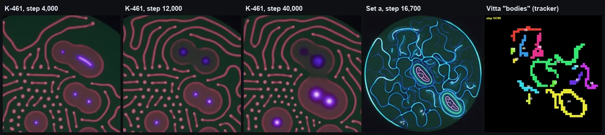
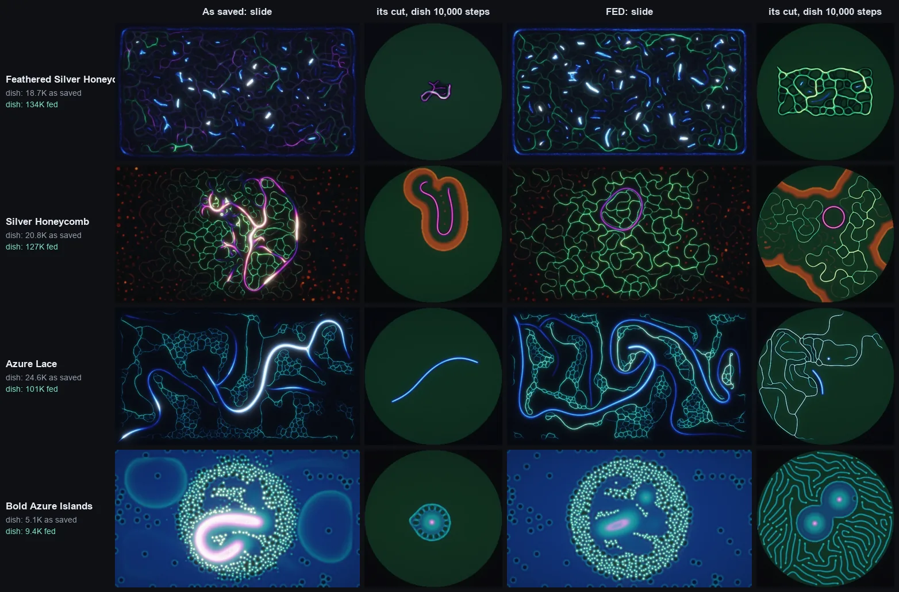
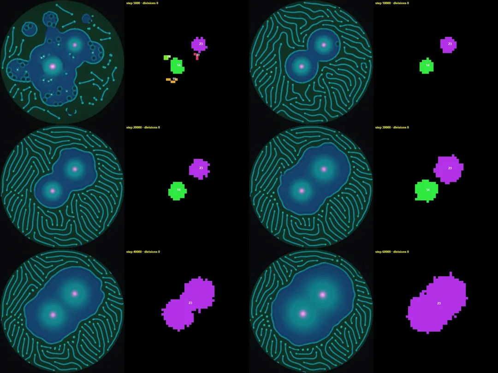
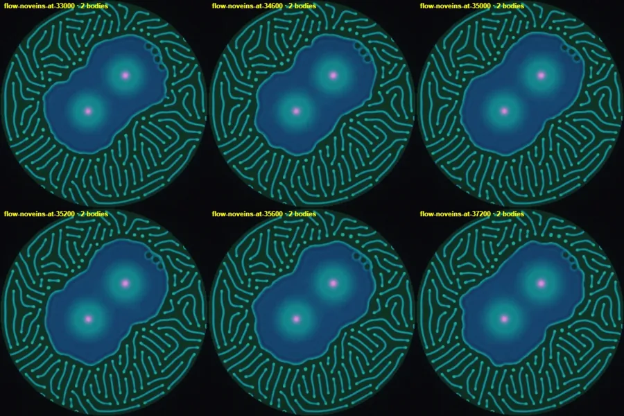
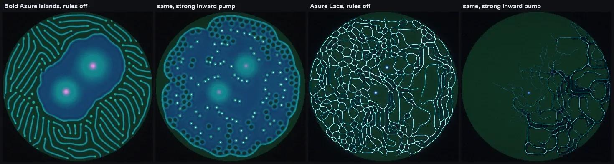
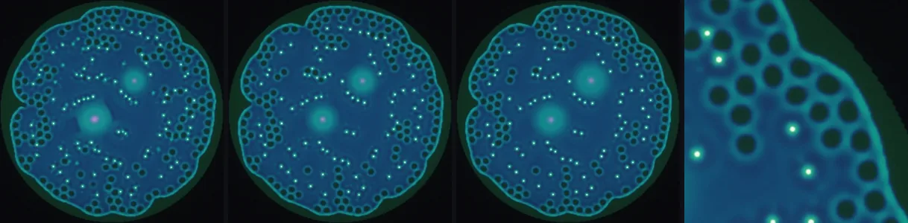

# The search for division

Reproduction is the one hallmark of life the sandbox does not show yet at the level of whole bodies. Particles divide
all the time, but no body has yet become two bodies that both live on. This page gathers every attempt to find or
cause that: what was tried, what happened, and what it taught. The negative results are the point. Each one rules
something out and narrows where division could come from. The measurements behind each step are in
[RESEARCH.md](RESEARCH.md), linked at each heading.

## How a division is judged

When one body becomes two, it is usually not reproduction: a thin bridge breaks and rejoins, a network's walls come
apart, or two bodies touch and part again. So a split only counts as a **division** if:

- both pieces are **solid bodies**, not thin walls or threads (at least 20% of each piece's squares are fully inside it);
- the smaller piece holds **at least 15%** of the parent, so shedding a speck does not count;
- both pieces **live on, apart, for 2,000 steps**;
- the parent has **not absorbed another body in the last 2,000 steps**, so two bodies touching and parting is not one dividing.

The Incubator applies these tests itself, counting bodies every 100 steps at any speed. A strain's DIVISIONS shows only
real ones, and the display says DIVISION when one is confirmed. A check in the test suite runs made-up bodies through
every case above.

## 1. Most "divisions" were walls breaking ([Looking for division](RESEARCH.md#looking-for-division))

The old count credited a strain with a division whenever one of its bodies became two. Tracked more carefully, set a's
membrane strain logged 12 lasting "divisions" over 30,000 steps, some even in a second or third generation. Its body
map showed what they were: stretches of a membrane network coming apart as it rearranged. Every one was a thin wall,
and the solidity test removes them all. Across two four-strain dishes and eight saved specimens run alone, **no body
divided**.

The nearest case was **Amoeba K-461**: one of its bodies split its glowing core in two inside a halo pinched into a
figure eight, the shape of a cell about to divide. Over 40,000 steps the halves never separated.

## 2. Bred on real food, specimens survive, but still do not divide ([Breeding on real food](RESEARCH.md#breeding-on-real-food-fed))

Specimens are bred in the Microscope, where food never ran out, so in a dish most first lost two thirds of their size.
BIOLOGY: FED gives the Microscope the Incubator's food rules. Across all 34 saved slides, cuts from fed slides typically
kept their size and most ended larger. No body divided.

## 3. The figure eight was fusion, not fission ([Breeding on real food](RESEARCH.md#breeding-on-real-food-fed))

Fed Bold Azure Islands ended as two ringed cells joined in a figure eight, which looked like a division under way.
Watched for 60,000 steps on three seeds, it was the opposite: two cores from the cut grew halos that pressed together
and merged into one body holding both cores, like a cell with two nuclei. The cores never multiplied.

One run logged a division in this pair. Pictures showed the cores never parted: they touched for one count and read as
one body, then as two again. That is why the fourth test above exists.

## 4. A hungry middle is not enough ([Breeding on real food](RESEARCH.md#breeding-on-real-food-fed))

A real cell is fed through its surface but eats with its whole volume, so the bigger it grows the hungrier its middle,
which is one reason cells divide. Our bodies already have this: the food deep inside them is a third to half of the open
broth's. Slowing the flow of food made them grow more slowly. Nothing split.

## 5. A membrane prototype ([A membrane prototype](RESEARCH.md#a-membrane-prototype))

In the dish, sunlight regrows food everywhere, including inside bodies, so a body's middle is fed mostly by its own
sunlight. A prototype added three particle-level rules (off unless switched on for research): crowding shades
regrowth, crowding blocks flow so a dense rim acts like a wall, and rim particles pump food inward at an energy cost.
On six fed specimens it gave **no division and no budding**, and the pumps did not raise the food inside bodies.
Shading made bodies smaller; blocking killed some.

The one new form: Bold Azure Islands with a strong pump filled the dish with a body rimmed with vacuole-like holes,
holding small granules. It hardly changed from step 5,000 to 30,000, and its granules were pieces of the cut kept alive,
not buds.

## What it has taught

- **Energy must be real, and specimens must be bred for it.** Both are now true, and they made dishes richer and
  specimens hardier, but not reproductive.
- **The first half of division already happens.** Cores split (Amoeba K-461) and two-core bodies form. What never
  happens is the body parting around them: a shared halo holds them together.
- **Nothing makes a large body unstable.** Homing, crowding and needing company to digest hold a small body and a large
  one together equally well, and food supply alone, even through a rim, did not change that.

## What is next

- **A body that loosens as it grows** ([IDEAS](IDEAS.md), B6), for example each particle keeping to its nearest core
  rather than to the whole body, so a two-core body could part at its waist. A rule change, so it would be described
  and tested first.
- **Breeding on FED across generations** in Batch, so selection itself can favor whatever divides.
- **Membrane material made by the particles themselves** ([IDEAS](IDEAS.md), further out).
