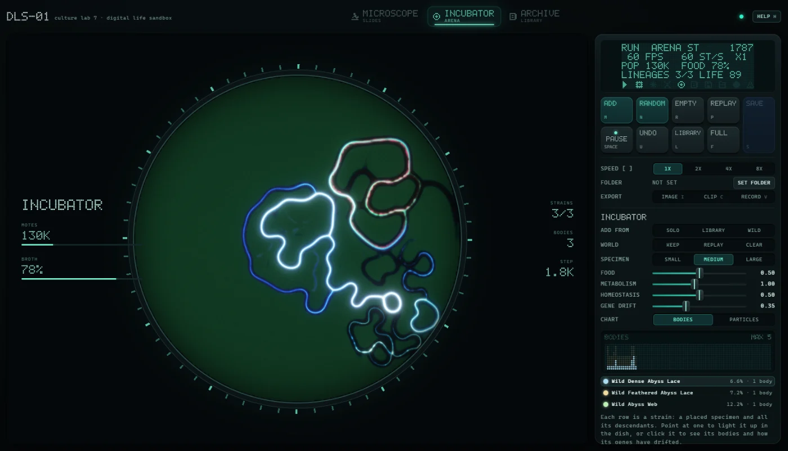
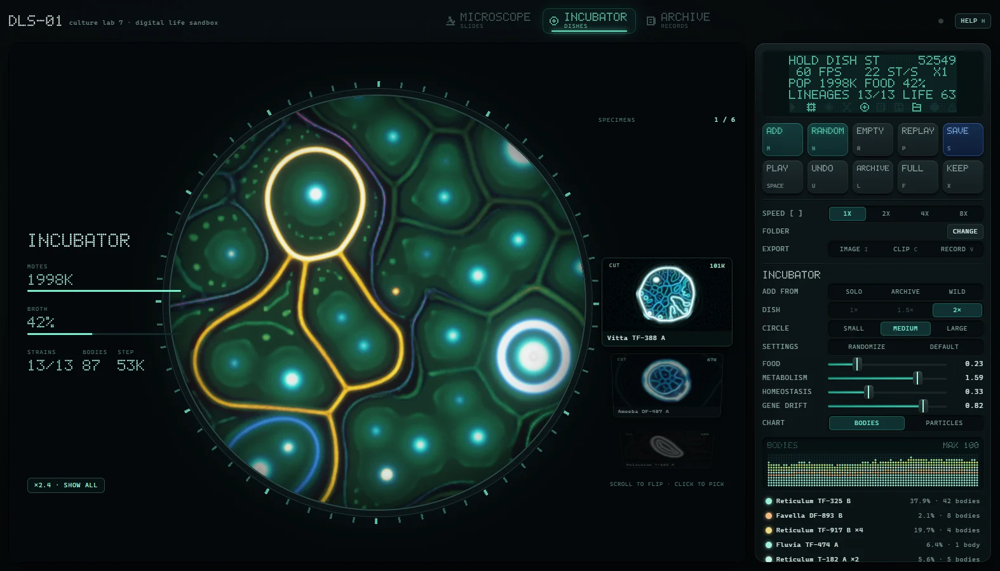
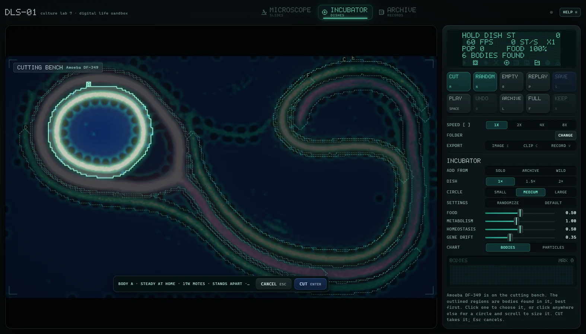
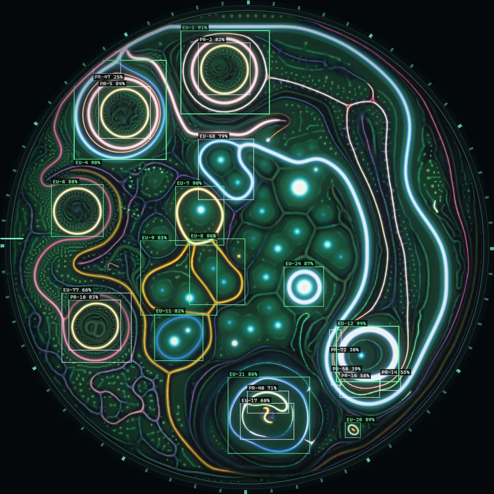

# Guide

How to use Digital Life Sandbox: the three rooms, the controls, breeding, the Incubator and the Archive. For how it
works inside, see [ARCHITECTURE.md](ARCHITECTURE.md); for the science, [RESEARCH.md](RESEARCH.md).

## The three rooms

You work the night shift in a culture lab (the story is in [WORLD.md](WORLD.md)). The room bar at the top of the screen moves between three rooms:

- **MICROSCOPE** holds your slides. **VIEW** switches between them (`B`):
  - **SOLO** shows one organism large. Adjust its sliders live and draw on it.
  - **BATCH** is a tray of nine variants. Click the ones you like, press **BREED**, and repeat. Double-click a tile to open it in Solo from where it currently is.
  - **CUT** (`X`) puts whatever is on screen on the cutting bench in the Incubator, however it got there: the Solo organism, or in Batch the slide under the pointer or the last one picked. Each slide also shows **CUT** and **OPEN** buttons when you point at it. Going back to the Microscope returns you to the view you left.
- **INCUBATOR** (`A`) is a round dish of broth where living specimens cut from your organisms eat, divide, mutate and compete. See [The Incubator](#the-incubator).
- **ARCHIVE** (`L`) is the Archive. **SLIDES** holds the organisms you saved from the Microscope, to explore and breed, shown as a **GRID** of cards or as their family **TREE**; it opens on the grid. The **LIVING** keys, each with a status light, hold what lives in the Incubator: **SPECIMENS** and saved **DISHES**.

The display shows a row of small icons. They light up while something is on and flash in color when it happens, such as breeding, mutating, saving or placing a specimen. A pressed control glows briefly and the glow fades the way the organisms' trails do. Outside the simulation, nothing moves.

Each Batch generation holds your kept picks, guided children, one plain child and one **WILD** child. With **FILTER** on, dead variants are replaced before you see them.

## Pads and shortcuts

| Control | Key | What it does |
|---|---|---|
| MUTATE / BREED / ADD | `M` / `Enter` | Changes the rules. **PASS ON** decides whether the grown body carries over. In the Incubator, adds a specimen |
| RANDOM | `N` | Rolls unrelated new organisms: species count, rules, ecology, field, start and colors. Batch keeps picked tiles. The Incubator grows and places a wild specimen |
| REROLL / EMPTY | `R` | Same settings, fresh start, leaving any inherited body behind. In the Incubator, press twice to empty it |
| REPLAY | `P` | Same settings and same start. An inherited body returns to its moment of birth. The Incubator replays its strains |
| SAVE | `S` | Saves the body and rules of the organism, or of every picked tile. In the Incubator, saves the whole dish to the Archive's DISHES, updating its entry if it was saved before |
| PAUSE / PLAY | `Space` | Freezes or resumes. The Microscope and the Incubator each keep their own; a new Incubator dish waits for PLAY |
| UNDO | `U`, `Ctrl+Z` | Reverses the last change, brush stroke or generation. In the Incubator, removes the last copy placed |
| LIBRARY | `L` | Opens the Archive: saved slides with their family tree, and the living specimens and dishes |
| FULL | `F` | Fullscreen |
| CUT / KEEP | `X` | Puts the organism on screen, or a Batch slide, on the cutting bench. In the Incubator it is KEEP: click a living body to save it as a specimen |
| View | `B`, `A` | `B` switches Solo and Batch. `A` opens or leaves the Incubator |
| Help | `H` | Hover over anything for an explanation. `H` works everywhere, and there is a HELP key in the room bar, the Archive and fullscreen |
| Draw page | `D` | Opens the brushes |
| Export | `I`, `C`, `V` | PNG image, seamless 6-second loop, 1080p recording. In the Incubator all three are square: the dish in its porthole with the bezel around it. The image is the whole dish at full size; clips and recordings film what you see, 1080 × 1080 |
| Speed | `[`, `]` | 1x to 8x |
| Tiles | `1`-`9`, `Shift`+`1`-`9` | Pick a tile, or open it |

## Control pages

The numbered menu under the settings opens one page at a time.

- **ORGANISM:** species count, ecology and movement sliders.
- **START** (on the settings above the menu) arranges the agents at step 0: SCATTER, RING IN, RING OUT, SHAPE or BLANK. **SHAPE** starts from a shape picked by the seed: several clusters, a swirl, or two groups side by side. The seed also sets the details, such as how many clusters and which way the swirl turns, so the same seed always starts the same way. With several species, each cluster or group belongs to one species, and a swirl gives each species its own ring. RANDOM and mutation can pick SHAPE too.
- **LIFE:** optional veins and living cells.
- **FIELD:** an optional reaction-diffusion chemical that agents interact with.
- **LIGHT:** color gradients, glow and exposure. These change the look only. Each organism has its own colors, which RANDOM rolls, children inherit and saves keep. In Batch, choosing a color recolors every slide in the tray. Glow and exposure are shared by all.
- **DRAW:** barrier and organism brushes, in Solo.
- **TASTE:** what the app has learned from your picks.

## Drawing

- **BARRIER** paints smooth, thick walls organisms cannot enter. **ERASE** removes them. The current run continues while you draw, then **GROW** starts a new run inside the drawing.
- MUTATE, RANDOM, REROLL, REPLAY and switching to Batch also pick up a new drawing. MUTATE keeps the grown body when barriers are added, so a structure can adapt to a new wall.
- Barriers are one shared world across Solo and Batch. **CLEAR** or **ERASE** reaches every tile and future child. Anything that grew around a removed barrier restarts, because its shape would otherwise remain as a ghost.
- **ORGANISMS: EMPTY** on the DRAW page removes all organisms, keeps the barriers and selects the organism brush. In an empty sandbox, barriers apply immediately. **FILLED** goes back to a normal start. **START: BLANK** is the same empty state.
- Children you breed inherit their parent's barriers. RANDOM keeps the current barriers too. Use **CLEAR**, then **GROW**, to remove them.
- **ORGANISM** places the chosen species wherever you hold or swipe the mouse. It moves existing or parked agents to the brush, so the total pool stays constant and performance is unaffected.
- Painted organisms are recorded by simulation step, so REPLAY and saves re-enact them. REROLL, MUTATE, RANDOM and breeding start without them.

## Inheritance and early life

Every organism has two parts. The **rules** are its settings. The **body** is the grown structure itself: every agent, trail, vein and chemical.

- **PASS ON** sits under MUTATION in the main controls and decides what children receive. **BODY + RULES** (default) starts each child inside its parent's grown body with mutated rules. **RULES ONLY** regrows each child from nothing.
- Every bred Batch tile is labeled **BODY + RULES** or **RULES ONLY** with what it actually received. In Batch, the display's fourth line shows **PASS BODY** or **PASS RULES**, and after BREED it confirms what the generation got.
- A child gets the rules only when there was no body to give, such as an unpainted BLANK sandbox. The tile label and the confirmation say so.
- With two picked parents, the child lives in one parent's body and mixes rules from both.
- **BIOLOGY: VEINS** thickens busy paths and withers unused ones, which helps structure survive new rules.
- **BIOLOGY: CELLS** adds veins plus energy, feeding, division, death and per-cell inherited rules. Followed trails act as food and fled trails as poison.

## Saves and breeding

- **SAVE always stores the body and the rules**, so a save reopens exactly as it looked. Each save uses about 5 to 20 MB. With CELLS on, expect about 7 MB at LOW or from a Batch tile, 27 MB at MED and 49 MB at HIGH.
- **No duplicates.** Saving the same organism again updates its existing entry, keeping its name, tags and family links. "Same organism" means the same seed, start, rules, biology, barriers and painting. Colors don't count.
- Opening the Archive folds any older duplicate saves into their newest copy. The kept save takes over their names, tags and family links, and the copies move to `saves/removed/`.
- **Automatic names.** Everything alive is named like a lab strain: a genus for its form, then a code, such as "Reticulum T-182".
  - The genus comes from the measured shape: Reticulum (web), Retiola (lace), Favella (honeycomb), Amoeba (islands), Hypha (branches), Fluvia (rivers), Vitta (ribbons), Filum (threads), Coccus (spores), Volvox (living cells) and Plasmodium (not yet measured).
  - The code's letters are **M**, **D** or **T** for one, two or three species, with **F** when it carries a reaction field. The number comes from the seed and rules, so the same organism always gets the same one; it moves on only if the name is taken.
  - A cut adds its body letter ("Reticulum T-182 A", or "disc" for a round cut). A wild organism's code starts with **W**, and a body kept from the Incubator is **K** in the genus of the strain it mostly came from ("Reticulum K-499"), or **C** when it was kept as a cell ("Reticulum C-389").
  - A saved dish is a **Monoculture**, **Coculture** or **Consortium** by how many strains live in it, with **S**, **M** or **L** for its size ("Coculture S-718").
  - Typing a name replaces it. Unnamed older saves are named when the Archive opens.
- **Older names were renamed once.** The first time the saves folder is read, every save with an automatic name, every specimen and every saved dish takes a name in the new form, together with the names they hold of each other: the save a cut came from, a kept body's origins and a dish's strains. A name you typed stays. Each keeps its old name as `formerName`: searching for it still finds it, specimen and dish cards show it as FORMERLY, and pointing at a save's name shows it.
- Each slide card shows **BODY + RULES** or **RULES ONLY**. RULES ONLY marks an older save that regrows from settings. Open it and SAVE again to store its body.
- Archive **BREED** passes on whatever PASS ON says, so with BODY + RULES the children start inside the saved body.
- Archive **CUT** puts a save on the Incubator's cutting bench, so a body cut from it goes into the specimen deck. Every card shows OPEN, BREED and CUT, whichever room you came from. See [The Incubator](#the-incubator). The save itself is never changed.
- **SLIDES** has a **GRID / TREE** switch under the Archive's top bar, and opens on GRID. GRID shows every save as a card, sorted by NEWEST, LIFE or A-Z. TREE shows your families, parents on the left and children on the right, with saves that have no relatives below them. Click a slide in the tree to light up its family and get OPEN, CUT and BREED for it at the bottom; double-click to open it.
- In the tree, a label like **+2 GEN** on a line is not a copy. It means two generations were bred in between without being saved.
- Removed saves don't appear in the tree. Their children connect straight to the removed save's own parents, and the +GEN label counts the removed generation.

Breeding never changes a save file. Children are new organisms until you save them.

## The Incubator

The two pages are two levels of selection. In Solo and Batch you choose bodies for their structure. In the Incubator, specimens of those bodies compete for food, and only the ones that can sustain themselves last.

1. Press **A**, or click **INCUBATOR** in the room bar. The INCUBATOR page replaces the organism pages. A new dish waits, paused, while you place specimens: nothing runs until you press **PLAY** (`Space`), which glows once specimens are in and the display reads PRESS SPACE TO START. EMPTY makes a new dish that waits again. The Microscope keeps its own PLAY and PAUSE.
2. Choose what to cut. **CUT** (`X`) in the Microscope sends the organism on screen, or a Batch slide, straight to the cutting bench. In the Incubator, the **ADD FROM** row does the same:
   - **SOLO** puts the organism you last had in Solo on the cutting bench. To use a different organism, open it in Solo first.
   - **LIBRARY** opens the Archive. Press **CUT** on any save to put it on the cutting bench. A save without a body is regrown out of sight first.
   - **WILD** grows a random organism, cuts its best body (or its densest part if it has none) and places it in the most open spot.

3. **The cutting bench** shows the organism with the bodies found in it outlined, best first, labeled A, B, C. Everything outside the chosen cut is dimmed.
   - Click an outlined body to choose it. A body inside another can be clicked directly.
   - Click anywhere else for a round cut, and scroll to size it.
   - **Steady at home.** While the bench opens, the organism runs on out of sight for 900 more steps, and each body is checked: did it keep its shape and size? The info bar says **STEADY AT HOME** or **CHANGES AT HOME**, and a changing body's letter is amber. A save is one moment, and some bodies change on their own even at home, such as a ring that pulls into a knot. Those will keep changing in the dish too. The cut's card in the deck says STEADY or CHANGES.
   - **CUT** (`Enter`, or the ADD pad) takes it. Esc cancels. The Incubator holds still while the bench is open.
   - The cut goes to the front of the **specimen deck**, named after its save and body, such as "Reticulum T-182 A", and placing begins. One save can give several specimens.
4. **The specimen deck** stands beside the dish. It holds the specimens you are working with, as cards with a picture and an edge in the color of how each was made, newest in front. The card in front is full size, and the others stand behind it above and below, smaller and tilted back, with a gap between each. **Scroll over the deck** to flip through it, one card per notch; the arrow keys work too. The counter shows which card is in front.
   - **The empty slot** at the bottom of the deck opens your whole collection, every specimen you have, with a search box. Pointing at one grows it a little to show what its test found. Choose one and its card joins the deck, in front, picked and ready to place. A new cut or keep joins the deck on its own.
   - **PUT AWAY**, above the deck, takes the card in front out of the deck. The specimen stays in the Archive, and the slot brings it back. **REMOVE**, beside it, deletes the specimen: press it, then SURE? within three seconds, and its files move to `saves/removed/specimens/`, as REMOVE on its Archive card does. Either way, strains already in the dish live on.
   - The deck is kept in your saves folder (`deck.json`), so it is there next session; it starts empty. Specimens themselves are saved in `saves/specimens/`. Without a folder, cuts stay for the session and their count shows in orange.
5. **Placing.** Click a card to pick it (a card behind comes to the front), then click the dish. While a card is picked it glows in its type's color and says PLACING, the deck's label reads PLACING, and scrolling over the dish sizes the next copy instead of zooming; drop the pick to zoom and drag again. Placing stays on, so each click adds another copy. Press **ADD** (`M`) for the most open spot. Esc, or clicking the card again, stops.
   - **Scroll over the dish** to size the next copy, from ×0.33 up to ×2 or what fits the dish. A copy's sensing reach and speed are scaled with it, so a larger copy behaves as a true larger version of the organism. Bold bodies hold together down to about a third of their size.
   - **The copies placed while one card is picked form one strain**, with one chemical identity, so they recognize each other as kin. Copies placed touching can fuse into one body. Picking the card again later starts a new strain.
   - **UNDO** removes the last copy.
6. The pads in the Incubator:
   - **KEEP** (`X`) saves one living body as a specimen: press it, then click a body; everything inside the ring is kept. Scroll to size the ring. Its light stays on while you choose.
   - **SAVE** (`S`) keeps the whole dish (see step 9).
   - **REPLAY** (`P`) places the same strains again and replays the same history.
   - **EMPTY** (`R`) removes every strain. It shows SURE? and empties on the second press.
7. **DISH** sets how much room the dish has: **1×**, **1.5×** or **2×**, which hold about 1, 2¼ and 4 times as much. Every specimen keeps its true size in every dish, so a larger dish holds more copies, not larger ones. Changing the size places the strains again where they were, measured from the middle, and starts the run over.
8. **Zoom and look around.** Scroll on the dish to zoom toward the pointer, and drag to look around; the round window never looks past the glass. While placing, the scroll wheel sizes the copy instead, and Ctrl with the wheel (or a touchpad pinch) zooms. **SHOW ALL**, bottom left, returns to the whole dish.
9. **Saving a dish.** **SAVE** (`S`) keeps the whole dish as it is now in the Archive under **DISHES**: every particle with its genes, both trail maps, the broth, any reaction field, and each strain with its chemistry, size limit and history.
   - **One entry per dish.** Saving the same dish again, in the same session or after opening it, updates its entry with the newest state; only the newest can be opened. A dish becomes a new one when you EMPTY it or change its size.
   - **Snapshots.** Each save also keeps a round picture of the dish at that step. The card shows the newest, and pointing at it plays every snapshot from the first to the newest, with its step. A new dish is also pictured as placed, the moment it first runs; that picture is only kept in memory, and the dish's first save adds it as its first snapshot, at step 0.
   - **OPEN** on its card puts it back in the Incubator exactly as it was last saved, at its own size, and it carries on. You can add more specimens to it. **REPLAY** then returns to its last save, with any copies placed since placed again, and **UNDO** only removes copies placed since.
   - Dishes are saved in `saves/dishes/`. Separate saves of one dish made before this change were folded into one entry: the newest state, the first save's name and a snapshot from each, with the older files moved to `saves/removed/dishes/`.
10. **Cells.** A dish grown from several specimens sometimes forms structures nobody placed: closed membranes around a living inside, often with a body inside like a nucleus. **CELLS: SHOW** puts a box over each one with its name and score.
   - A name is **EU** (eukaryote-like: it has a body inside) or **PR** (no body inside), then the order the dish first saw it in, such as EU-7. These names belong to the dish.
   - The score multiplies five parts, so a cell needs all of them: a **closed wall** brighter than the broth outside, around an inside unlike the broth; an outline that **holds still and keeps its particles in**; particles that **keep moving inside**; **bodies and several strains inside**; and **age**, which counts up over about 1,500 steps. A box turns **green** for an EU cell at 80% or more. Cells under 25% get no box.
   - The dish looks every 150 steps, whether or not cells are shown, and follows each cell by where it is. A cell is listed once it has been seen three times, and dropped after three looks without it.
   - The CELLS row sits below the settings sliders, so the controls you adjust never move. Under it are three slots for the dish's **three best cells**, with score, age and the strains they are made of. The slots keep one height, so nothing below them moves as cells come and go.
   - Point at a slot to light its cell in the dish while the others dim; click it to zoom to it. While you point at the list it holds its order and only the numbers change, so KEEP CELL takes the cell you aimed at. It sorts again when the pointer leaves.
   - **KEEP CELL** cuts that cell along its own outline, with every gene its particles evolved, and files it as a specimen named with **C**, such as "Reticulum C-389". Its deck card says CELL and its score; its Archive card is amber, shows its score as a readout and its name in the dish under its name, and gives the saved dish it came from, its age and strains when you point at it. Placed in a dish, it is laid down whole.
   - A saved dish keeps the cells it was following, so their ages carry on when it is opened or replayed.

**How bodies are found on the bench.** Particle density is measured on a 240x135 grid. Dense regions are followed from the tightest threshold to the loosest, and a region that keeps its own identity over several thresholds stands apart from its surroundings: that is a body. Each body is filled in, so a membrane keeps whatever it holds, and ranked by how well it stands apart, how steady it is, whether it encloses space or has a brighter rim, and its size. Trail piled along the frame is ranked down. The cut follows the body's own outline with a small margin, so strands of network passing by stay behind.

**How cells are found.** A small GPU pass takes the dish's glow as it is shown, averaged over 8-pixel squares, and a sample of up to 131,072 particles. On that grid, enclosures are found at eight brightness levels: spaces the walls close off from the open broth, and closed outlines, each filled in with whatever it holds, so a cell inside a cell counts as a body of the bigger one. A cell must close at three levels or more, be at least 16 squares and at most 8% of the dish, and be compact, so the corridors between membranes are not cells. Cells are matched from look to look by overlap, closest first, and a cell much smaller than another is never taken for it, so an inner cell keeps its own name. The work is spread over several frames so the dish keeps moving, and it only reads the dish: a run is the same whether cells are shown or not. The research behind it is in [RESEARCH.md](RESEARCH.md#finding-cells).

**What carries over.** A specimen keeps its particles where they were, the trail and veins beneath them, and each particle's own rules. Living cells keep their inherited multipliers. It is cut at its own scale, with the trail cropped to the box around the body's outline, so a long body keeps both ends. Only a body too big for the dish, wider than about 84% of the picture height, is shrunk evenly to fit, and the bench says so. A body keeps its full density unless it would take more than 40% of the world. A body from an organism with a reaction field takes the field from under it too, with the same soft edge, along with the field's recipe and how strongly each species follows or flees it.

**What each particle carries:**

- **Movement rules** from its species, as in Solo.
- **A target density**, imprinted from the density it actually lived at when cut. Vein particles want vein density, and rim particles want rim density. It drifts slowly toward its new surroundings, so a transplanted body can adjust instead of starving.
- **A chemical of its own.** The dish has six chemicals. Each species placed gets one of its own while any are free, and its trail fades and spreads at exactly its home rate. That matters: when species share a chemical, its fade is an average, and a species whose trail used to last 500 steps loses the trail it follows. Each species also follows and flees the others of its organism exactly as it did at home, and shows in its organism's own colors. Toward a chemical that isn't its own organism's, a species behaves as toward a stranger: with half the attitude it had toward its partners at home, or a slight wariness if it had none. Once all six chemicals are taken, a new species shares the one whose trail behaves most like its own, and species sharing a chemical smell alike. A strain keeps the chemicals it was given, and its chemistry can still evolve.
- **Energy.** Particles digest food best near their target density and with kin around, so a loner can barely eat. However low a particle's target density, it digests well only where its kin are at least moderately dense, so living spread thin never pays. They divide when full, pass slightly mutated genes to their daughters, and die when starved. Food is the dish's only source of energy: each cell's food is shared among the particles in it, and they never take more than it holds.

**The world:**

- **Food** regrows like sunlight, and dead particles return to it. It is the dish's only source of energy, so it sets how many particles a dish can feed. In tests, dishes of fresh specimens held 53 to 56% of their room after 20,000 steps at the default FOOD of 0.75; one held there through 40,000 steps, while another, with a thrifty lace strain, kept spreading to 96%.
- **Food flows** across the broth into bodies, and faster still along veins, the way *Physarum* streams nutrients through its tubes. A dense body eats out its own patch quickly, so without this flow it starved with food all around it.
- **PATCHES** (a slider under the settings) sets where food grows back. At 0 it grows evenly everywhere. Turned up, it grows mostly in a few soft patches of sunlight that slowly circle the dish, each lap taking tens of thousands of steps, so a body that sits still sees its food drift away and moving pays. The total amount of food is the same at every setting, and the broth's glow shows where the patches are. The patches follow the dish's own clock, so a replay or a reopened dish moves them the same way.
- **FOODS: ONE / TWO.** With TWO, a second kind of food grows in its own patches and glows in a warmer color; each grows half as fast, so the dish holds as much in all. Every particle carries a **diet** gene from 0 to 1: at 0 it digests only the first food, at 1 only the second, and in between both, but less well in all, so a strain that specializes does better at its food than a generalist. Diet mutates like any gene. Each specimen starts with a diet of its own, from its name, so different strains lean toward different foods, and the strain stats show how it has drifted.
- **CHALLENGES.** PATCHES, HUNTING and FOODS sit apart in the settings under **CHALLENGES · OFF TO START**. A new dish starts with them off: PATCHES and HUNTING read OFF and are dimmed, and FOODS is ONE. Specimens come from the Microscope, where food never runs out and no one hunts, and each challenge, on from the start, shrank a dish of fresh specimens. Moving a slider up turns it on, lights its name and shows its value, and the display says so (HUNTING ON); back at 0 it is OFF again. RANDOMIZE and DEFAULT leave the challenges as they are. **Dishes saved before** PATCHES and FOODS existed open with PATCHES 0 and FOODS ONE, so they run exactly as they did.
- **Reaction fields.** A body that lived in a reaction field brings it, and its particles carry the field's recipe: the feed and kill rates of its Gray-Scott reaction and how strongly its trails seed it. They give the recipe off where they live, so the field runs where the strain is, follows it as it moves, and fades back to plain broth where no strain keeps it. Strains with different fields can share the dish. Each species follows or flees the field as strongly as it did at home, and the field glows in its organism's field colors.
- **Nothing caps a strain's size.** A strain grows as far as its food allows, so strains gain and lose ground against each other. The dish also has room for a fixed number of particles (half a million to two million, by size), but food runs out first. An earlier rule that held each strain near the size it was placed at was removed, because it counted the whole strain across the dish rather than acting on single particles (see [Which rules carry the cells](RESEARCH.md#which-rules-carry-the-cells)).
- **Homing.** A particle that has wandered away, sensing little of its kin where it stands or where its sensors reach, turns back. Swarming bacteria such as *Myxococcus* reverse direction in a similar way to stay with their swarm. Without homing, a wanderer has nothing to steer by, lays a trail others follow, and the body frays into a spreading network.
- **SETTINGS: RANDOMIZE** sets the four main sliders below at random (not the challenges), more often near the middle of each, and never with less than 0.75 food, below which a dish of fresh specimens can lose strains. **DEFAULT** puts them back (FOOD 0.75).
- **FOOD**, **METABOLISM**, **HOMEOSTASIS** and **GENE DRIFT** shape the competition. HOMEOSTASIS sets how reliably lost particles turn back, how hard crowding pushes out, and how narrowly they digest around their target density. At 0 the Incubator behaves like classic slime and bodies fray into spreading networks. From about 0.5, bodies stay separate individuals.
- **Inherited cohesion.** Each particle also carries its own **homing** (how reliably it turns back when lost) and **crowding** (how hard it is pushed out of places denser than its set point), as multiples of HOMEOSTASIS. Both start at 1 and mutate with GENE DRIFT, so a strain can evolve to hold together more or less, and holding together can win or lose. A kept body keeps them. Dishes saved before this open with both fixed at 1, so they run exactly as they did.
- **HUNTING** (a slider under the settings) sets how much predation pays; 0 turns it off. Every particle carries a **hunting** gene from 0 (grazes) to 1 (hunts):
  - A hunter digests food less well the more it hunts, is drawn to smells unlike its own, and bites strangers it bumps into, taking part of their stored energy. Only half of what it takes reaches it; the rest is lost, as in real food chains. A particle drained of energy dies and its matter returns to the broth.
  - **Kin are spared by a kin mark**, a gene every particle of a placed specimen shares, sister species included, like the immunity genes that let bacteria kill strangers on contact but spare their kin. It drifts slowly by mutation, so distant lineages can become strangers to each other.
  - **Safety in numbers:** a particle surrounded by its own kind gives up only half as much to a bite, measured the same way digestion measures company. Loners and frayed edges are easy prey.
  - In tests, a strain whose particles came to hunt grew, ate its prey down and crashed; afterwards three strains shared the dish for 70,000 steps with none taking over, in a much thinner dish. Higher HUNTING thins the dish more.
  - Particles start with their own hunting, drawn separately for each: most near 0, about one in five above 0.5, the same spread for every specimen. Which strains end up hunting is decided in the dish, and the strain stats show it.
  - New dishes start with HUNTING OFF, since predators on from the start shrank a dish of fresh specimens most of all; turn it up as a challenge. Dishes saved before it existed open with it off, with no one hunting, so they run exactly as they did.

**What you can see:**

- **The readouts beside the dish:** PARTICLES is how many particles are alive, and its bar how full the dish is. BROTH is the food left in the dish. STRAINS counts the strains still alive of those placed, BODIES the separate bodies across all of them, and STEP how long the dish has run. Point at any of them with help on (`H`) for more.
- **ECOSYSTEM**, under those readouts, scores from 0 to 100 how much the dish behaves like an ecosystem of separate living bodies over its last 3,000 steps. Five bars show its parts, multiplied so a dish needs all of them: **COEXIST** (how many of the strains you placed are alive, and how evenly they share the dish), **PERSIST** (how long its oldest bodies have lasted, near full after about 12,000 steps), **EXCHANGE** (strains trading ground: when one rises another falls, as competitors for the same food do), **BALANCE** (the dish as a whole steady, without a crash or boom) and **STRUCTURE** (separate bodies rather than an even mush: full when the densest tenth of the dish holds about 70% of its particles, empty at about 30%). It shows `--` until the dish has 3,000 steps of history. It is saved with the dish and shown on its Archive card. It only reads what the dish counts, so it never changes it.

- **CHART: BODIES** is an LED display that stacks how many separate bodies each strain has over time, in its chemical color. For life-like behavior, this matters more than size: it shows whether a strain stays as individuals, divides, or merges into one sprawl. **PARTICLES** stacks each strain's share of the world instead.
- **Strains:** each placed specimen founds a strain, which is the specimen and all its descendants. Each row shows the strain's share of the world and its number of bodies. Point at a row to light that strain up in the dish while the others dim. Click one to see:
  - its particles and bodies;
  - its largest and oldest body;
  - divisions (only real ones: see below; the number waiting counts splits that may still become divisions), body deaths and typical body lifespan;
  - energy;
  - how each gene has drifted since it was placed: set point, speed, sensor angle and reach, deposit, foraging, diet (with two foods), homing and crowding (as multiples of HOMEOSTASIS; "fixed in this older dish" for a dish saved before they existed), hunting (with HUNTING above 0), and chemistry shown as a color swatch.
  - **KEEP LARGEST BODY** saves that body as a specimen.
- **How bodies are found:** where a lineage is dense on a grid of 20-pixel cells (96x54 in a 1× dish), each connected patch is a body. Bodies are counted every 100 steps of the dish, at any speed, and followed by overlap from one count to the next.
- **Divisions.** Most times one body becomes two, it is a thin bridge breaking and rejoining or a network's walls coming apart. A split only counts as a **division** if both pieces are solid bodies rather than thin walls, the smaller holds at least 15% of the parent, and both live on, apart, for 2,000 steps. The display says DIVISION when one is confirmed. In tests so far no dish has shown one: the nearest, Amoeba K-461, split a body's core in two inside a figure-eight halo but never separated (see [Looking for division](RESEARCH.md#looking-for-division)).
- **Clicking a strain row** also flips the specimen deck to that strain's card, if it is in the deck.
- Each species shows in its organism's own colors, unless another species already shows in them, in which case it borrows a free gradient. A strain's swatch blends the colors of the chemicals it gives off.

**Specimens.** A cut specimen holds the particles inside its outline with their species' rules, and the trail beneath. A kept specimen holds every particle inside the ring, of any lineage, with every gene it evolved, plus the trail and veins beneath; a kept cell holds those inside its outline instead. Both are saved in `saves/specimens/` and listed in the Archive under **SPECIMENS**; the deck holds the ones you choose.

**Specimen cards.** In the Archive every specimen is a card of the same size, its picture seen through a porthole, as it goes into a dish:
- **Type:** the ridged grip down the left, the porthole's ring and the icon in the readouts show how it was made: microscope and teal for a cut from a slide, a filled body and blue for a body kept from the Incubator (such as the largest body of a strain), a ring with a nucleus and amber for a kept cell, a spark and orange for a cut from a wild organism.
- **Genus coin** on the porthole's rim: the emblem of its genus, the first word of its name (web, lace, honeycomb, islands, branches, rivers, ribbons, threads, spores, colony, or a question mark when not yet measured).
- **Readouts:** PARTICLES; SPECIES for a cut or STRAINS for a kept body, with F when it carries a reaction field (such as 3F); or CELL and the score of a kept cell; then the TYPE icon.
- **Meters** from its test: TRAVEL, HOLD and SIZE, up to five lights each, with its sentence below (see Testing specimens). They stay dark until it is tested.
- **PLACE IN DISH** adds it to the deck and picks it; **TEST** shows while it has no current test; **REMOVE** moves its files to `saves/removed/specimens/` (press twice).
- Point at a card for its details: where it came from, any former name, and for a kept body its set point, speed, sensors and the strains it came from.

Cutting the same body from the same moment twice brings the existing card to the front instead of making a second one, and duplicates already in the folder move to `removed/specimens/` when the deck or Archive reads them. Added back to an Incubator, a kept specimen's particles keep their own genes and set points.

**Testing specimens.** Each specimen card in the Archive has three meters and one sentence on what the specimen did when tested alone in a standard dish, such as "Forms a ring, stays put and shrinks to under half its size." TRAVEL lights by how far its bodies moved (one for staying put, five past 800 pixels), HOLD by its form (five for one solid body or a ring around another body, four for a ring, three for a net, two for a loose body or a split, one for many pieces or spreading thin), and SIZE by how its particles changed (one for losing most, five for growing). The sentence also shows under the deck in the Incubator for the card in front.
- **TEST** on a card, or **TEST ALL** above the cards, runs the test: a fresh 1× dish with the default settings but the food tests have always had (FOOD 0.5 at today's sunlight), PATCHES 0.5, one food and no hunting, the same seed every time, and the specimen in the middle at its true size, for 5,000 steps. It takes about 8 seconds a specimen; the bar above the cards shows how far it has got, and **STOP** or closing the Archive stops it.
- The sentence is measured from the dish, never read from the genes:
  - **Form**, at the end: one solid or long body, a ring (one large hole), a ring around another body (the cell-like case), a net (many small holes), split into two or three bodies, broken into many (four or more, each holding at least 5% of its particles), or spread too thin to form a body.
  - **Travel**: how far its bodies moved in all, in pixels of a dish 1,080 high, counting a typical stretch so a shed piece doesn't read as a jump: stays put (under 120), drifts, wanders, or travels far (over 500).
  - **Size**: its particles at the end against those placed. Most specimens shrink at first, as they settle to the food the dish can give.
  - **Field**: whether its reaction field ends up covering most of the dish.
- The Incubator runs one dish at a time, so the dish in it is set aside during a test and put back exactly as it was, ready to carry on.
- The result is saved in the specimen's description file. If the Incubator's rules change in a later version, older results say so and TEST ALL runs them again.
- The world is round: the largest circle that fits the picture. Particles, food, trail and placed specimens all stay inside the glass.
- The dish sizes, measured on an RTX 4070 with a well-filled dish. Each holds 60 frames a second; a larger dish costs more per step, so its fastest speed is lower. Up to 16 strains, each thinned to at most 40% of the dish's particle places.

  | DISH | Picture | Particle places | One step | Fastest |
  |---|---|---|---|---|
  | 1× | 1920x1080 | 500,000 | 1.4 ms | 8x |
  | 1.5× | 2880x1620 | 1,125,000 | 3.5 ms | about 3x |
  | 2× | 3840x2160 | 2,000,000 | 6.0 ms | about 2x |
- **REPLAY** places the same strains again and reproduces the same history exactly.

The design reasoning, the research behind it and what was measured are in [RESEARCH.md](RESEARCH.md#the-arena).

## The LIFE score

The LIFE score is a rough 0 to 99 measure of life-like structure. Help mode shows its parts when you point at a tile or the display.

- **Version 2** rewards **bodies**, meaning bounded structures that stand apart from their surroundings, and **variety** across the frame. Flow, webs, contrast, shape, balance and motion still count, but less.
- An even texture filling the whole frame now scores about 55.
- Trail hugging the border and straight horizontal and vertical lines are marked down. A frame locked into a grid gets the new **GRID** verdict and is filtered like other dead variants.
- **NOISE** now also requires that no closed structure formed, so jagged crystal lattices are no longer called noise.
- It was checked against saves tagged as scoring too high or too low. All five moved the right way: 99→55, 95→52, 92→19 (GRID), 75→87 and 19→81.
- Older saves keep the score they were saved with.
- In the Archive, with Help on (`H`), pointing at a card's LIFE chip shows its parts. Saves from before version 2 lack BODIES and VARIETY, and the card says so.

## Known limitations

- Older RULES ONLY saves regrow at most 3,000 steps when reopened. Saving them again stores their body.
- A browser without folder access can only download the rules.
- After a save is reopened, REPLAY returns to the saved moment rather than the organism's birth.
- A body file is compressed with very slightly rounded trail values. Agents, genes and chemical are exact.
- An automatic name's genus comes from a few measurements of form, so organisms of the same form share a genus and differ only in their code. Colors no longer appear in names.
- Undo and old generations may fall back to their recipe once the 1.5 GB body memory fills.
- A child inherits one parent's body. In the Incubator, separate bodies share a world, but they never fuse into one organism.
- Incubator membranes are rings of particles held by density preferences. Their wall is not built from a material the cell makes itself.
- In the Incubator, whole bodies have not yet been seen dividing into two. Runs of 3,000 to 4,000 steps showed coexistence, spreading networks, persistent rings and lineages invading each other.
- A dish's strains and history are lost when the page closes unless the dish is saved with SAVE. A saved dish rounds its trails very slightly, like a body file; everything else is exact.
- A strain that came with a saved dish can't be placed again from scratch, because the dish keeps the strain, not the specimen it grew from. KEEP a body to make a new specimen of it. A saved dish always opens at the size it was saved at.
- A saved dish file is large: about 19 MB for a 1× dish and 30 MB for a lightly filled 2× dish.
- Specimens cut before the crop fix keep their cropped trail: a body wider than its slide was tall lost the trail at its ends. Its particles are all there and lay new trail, but cutting it again gives a clean copy.
- Body counts and deaths in the Incubator are measured on a coarse grid, so they are approximate. Divisions are judged strictly, so a real one can be missed, for example if a piece briefly thins below a body's density.
- The cutting bench finds bodies from particle density on a grid of 8-pixel cells (4 pixels on a Batch tile), so outlines are stepped, and a faint body in a dense network can be missed. A round cut is always available.
- WILD specimens are placed but not filed in the specimen deck. KEEP a wild body you like to save it.
- A reaction field in the dish lives only where a strain keeps it, so the field that filled the whole picture at home covers only the body and a margin around it. All fields in the dish glow in the colors of the first strain that brought one.
- A copy placed smaller than ×1 has its field's pattern scaled down with it. A copy placed larger keeps the field's pattern at full size, because spreading it further would make the reaction unstable.
- The dish has six chemicals. Past six species, a new species shares the chemical whose trail behaves most like its own, so it fades at an average rate and smells like the species it shares with.
- A strain's size limit counts the whole strain, so in a strain of several species one species can fill the room left by another that dies out.
- There is no WebGL2 fallback.
- A hidden browser tab or preview pane throttles animation, so frame-rate measurements there are not meaningful.
