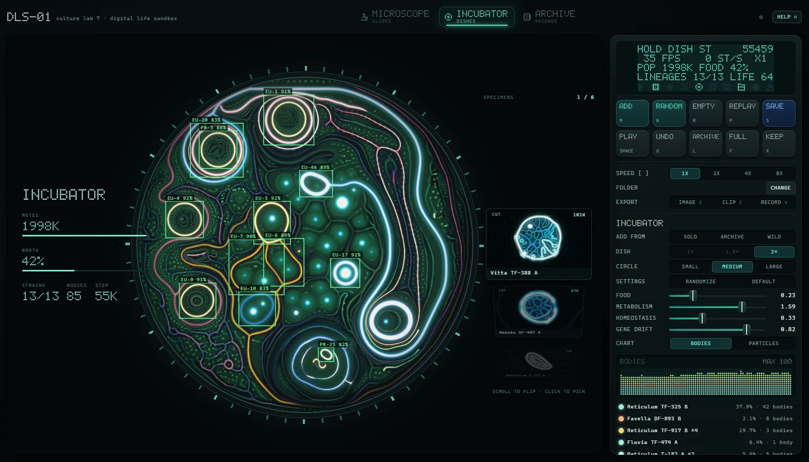
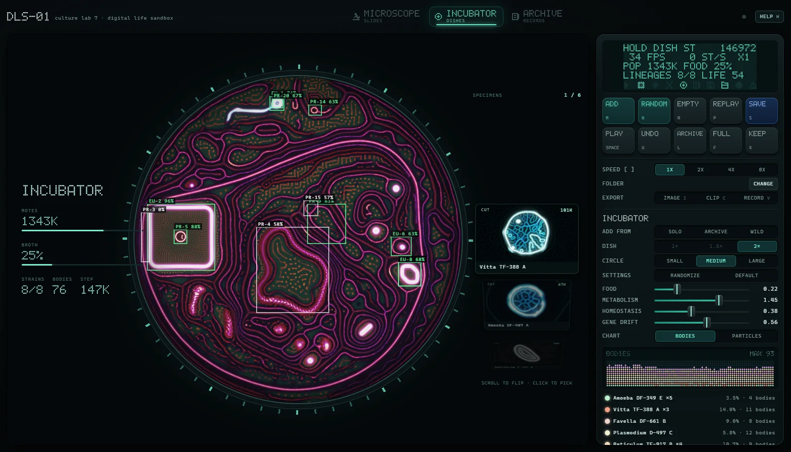

# Research Behind the LIFE Systems

This explains which published ideas shaped the sandbox's early-life features, what was changed to fit them into a GPU agent simulation, and what has been measured. These sources **inspire mechanisms**. The sandbox does not reproduce their models or claim to simulate real biology.

## The central idea

Breeding originally copied only settings, so every child regrew from nothing. Living things also inherit **organized matter**: a cell receives its parent's membrane, cytoplasm and internal structure, along with its genes. The sandbox now does the same. A child wakes up inside its parent's grown body with changed rules, and that body has to adapt or dissolve.

## How each idea is used

| Idea | Source | In the sandbox | Main difference from the source |
|---|---|---|---|
| Inherited structure | Beisson & Sonneborn, 1965 | **PASS ON: BODY + RULES** copies every agent, trail, vein and chemical into the child | Theirs is a change in a cell's cortex passed to descendants. Ours is a full copy of a simulated world |
| Use-it-or-lose-it tubes | Tero, Kobayashi & Nakagaki, 2007 and Tero et al., 2010 | **VEINS** strengthen where trail is busy and fade where it is not | Local trail level stands in for true fluid flux, with no pressure network |
| Parameters that travel with matter | Plantec et al., 2022 (Flow-Lenia) | **CELLS** each carry their own inherited copy of the movement rules | Stored per agent rather than per grid cell |
| Growth sweet spot | Lenia growth function, as given in Flow-Lenia | Cells gain energy at a preferred density and lose it when too sparse or crowded | Applied to the trail an agent stands on |
| Metabolism, boundary, heredity | Gánti's chemoton | Used as a checklist for what "early life" needs | Metabolism and heredity are modeled. A true self-made membrane is **not** built yet |
| Heredity before genes | Vasas et al., 2012 | Motivates treating a self-maintaining structure as something selection can act on | No chemical reaction network is modeled |
| Agent-based Physarum | Jones, 2010 | The base simulation's family of models | The sandbox extends it with species, fields and energy |

## The rules as implemented

**Veins.** The Physarum adaptation rule is `dD/dt = f(|Q|) - μD`, where `D` is tube conductivity, `Q` is flux and `f` is an increasing function. The sandbox uses `f(q) = q² / (1 + q²)` with `μ = 1` and a slow time step. This specific `f` is a design choice. A thick vein holds trail longer and attracts more agents.

**Energy.** Each step, a cell's energy changes by `metabolism × (G(x) - moveCost × speed)`, with `G(x) = 2·exp(-(x - μ)² / 2σ²) - 1`. This is the Lenia growth curve. `x` is the log of the trail the cell can eat, and each cell's preferred `μ` is inherited.

**Food web.** The FOLLOW matrix doubles as diet: a trail a species follows feeds it, and a trail it flees harms it.

**Division.** A cell with enough energy claims an empty place in its species' pool, splits its energy with the daughter, and passes on slightly mutated rules. Claims are resolved with an atomic maximum, so runs stay exactly repeatable on the same hardware and browser.

**Death.** Cells die when energy runs out and also wear out at random. Without this turnover, a well-fed population never opens room for new offspring, and evolution stops.

## What was measured

All tests ran on the project's RTX 4070 at LOW quality with randomly generated organisms. "Structural match" is the correlation between a parent's trail map and its child's, at 120×68 resolution. Even unrelated runs score about 0.3, partly because all runs share a dark border.

| Child's start, 600 steps after birth | Match with parent | Test size |
|---|---|---|
| Rules only | 0.29 | 8 organisms |
| Inherited body | 0.54 | 8 organisms |
| Inherited body, veins off | 0.45 | 6 organisms |
| Inherited body, vein memory 0.60 | 0.54 | 6 organisms |
| Inherited body, vein memory 1.00 | 0.63 | 6 organisms |

Living cells were then run for 3,000 steps on 8 random organisms:

- None went extinct, and all 8 finished with a living structure.
- Population settled anywhere from 18% to 100% of capacity.
- Offspring developed real inherited variation.
- The average speed gene fell slightly below its starting value in all 8 runs, and preferred density rose in all 8. This is consistent with weak selection, but the effect is small and the sample is limited.

## The Arena

Organisms in these notes are named as they were when each test ran, such as "Silver Web V". They have since been renamed like lab strains ("Reticulum T-182"), and each keeps its old name, so searching the Archive for a name used here still finds it.

### The question

How can bodies grown in the sandbox, with their structure and the way they behave, become building blocks for a particle-life world where they interact and evolve?

### How the design was reached

Each time a design seemed settled, the next step was to ask whether it was truly a new and likely-to-work approach, and to look one level deeper.

1. **Map settings to a particle-life force table.** Rejected: the grown structure is lost.
2. **Cut a living piece of the body.** Keep its particles, trail, veins and each particle's rules. This keeps the structure, but alone it gives nothing that keeps a piece together.
3. **A slime agent is nearly a Particle Lenia particle.** Its three sensors sample a field on a ring at sensor distance, which is Particle Lenia's ring kernel. The trail plays the part of Particle Lenia's field U. The difference is the growth curve: slime always wants more trail, while Particle Lenia prefers one density. Adding a crowding penalty above a preferred density turns slime sensing into Particle Lenia's energy, *E = R − G*. With the penalty off, it is classic slime again.
4. **Slime has memory that particle life lacks.** The trail records where particles *were*, the way Physarum's extracellular slime and a biofilm's matrix do. Specimens carry this memory into the arena.
5. **Imprint the structure into the rules.** Each particle's preferred density is set from the density it actually lived at when cut. The body's grown form becomes heritable rules, much like Waddington's genetic assimilation, where a form first produced by circumstance becomes encoded.
6. **Chemical identity instead of a hand-made force table.** Each founder gives off a mix of three shared chemicals. Its responses are solved so its own species' FOLLOW settings hold exactly. How it treats other founders then follows from how alike their chemicals are. With only three channels the interactions are low-rank, as in real signalling, and identity can drift, so mimicry and recognition can evolve.
7. **Shared fate.** A particle digests food only with chemicals it is drawn to, and best near its preferred density. Matter is conserved, and only regrowing food adds energy.

### Rules as implemented

- **Steering:** score = Σ response × chemical + forage × food × kin(*u*) − crowding × max(*u* − set point, 0)². Here *u* = log(1 + usable chemical), and veins add pull as in Solo.
- **Digestion:** kin(*u*) × exp(−(*u* − set point)² / 2σ²), with kin(*u*) = *u*² / (*u*² + 1). That is a Hill curve, the form used for cooperative binding. HOMEOSTASIS sets σ and the crowding strength.
- **Eating:** each particle takes food in proportion to what it can digest. Undigested food stays.
- **Food flow:** food spreads between neighboring cells at a rate set by their conductance. Veins conduct best, plain trail a little and open ground barely, like cytoplasmic streaming in Physarum's tubes. Flow is symmetric, so food is moved, never made.
- **Matter:** a particle is 0.3 units of matter plus its energy. Division splits both. Death returns both to the food field. Living costs energy that is not returned, and regrowth adds it, like sunlight.
- **Acclimation:** the set point moves 0.07% of the way toward the density actually experienced each step. The inherited value is a starting point, like phenotypic plasticity.
- **Homing:** if the most kin a particle senses, where it stands or at any of its three sensors, is below 35% of its set point, it reverses heading, with probability equal to HOMEOSTASIS. This resembles the direction reversals *Myxococcus xanthus* uses to stay with its swarm.
- **Heredity:** daughters inherit every gene with small changes, including the chemical identity. Claims use atomic maximums, so runs replay exactly.

### What happened as it was built

Every run below used the same four cached specimens, the same seed and LOW-to-MED founders on the RTX 4070.

| Version | Result |
|---|---|
| Classic sensing, simple eating | One colony grew from 33K to 200K particles and **spread over the whole world**. The average preferred density fell from 1.39 to 0.43 |
| Gated digestion | Everything starved. Particles removed food they could not digest |
| Eat only what you can digest | Populations held, but colonies still spread into territories that fill the world |
| Stronger homeostasis | Preferred density still **evolved downward**, from 2.0 to 0.8 |
| Cooperative Hill curve, foraging only near kin | **Bounded bodies formed**: rings and cell clusters. They starved slowly, with up to about 200 particles per food cell |
| Food flows through veins, faster eating | Populations stable or growing. A network lineage spread while ring bodies persisted |
| Acclimation, thinning large specimens | A body grown in a reaction-diffusion world survived transplant as a **membrane ring with particles of its second species inside**. All five lineages coexisted after 3,200 steps with food steady near 77%. Arena LIFE score 88, bodies part at maximum |

The downward drift of preferred density matches a known effect called **spatial sorting**. In an expanding population, the best dispersers end up at the front and breed with each other, as with cane toads evolving longer legs at their invasion front. Here, pioneers at the edge found fresh food. Individuality only held once cooperation made loners pay a real price.

Checks:

- Two replays of the same founders gave identical trail hashes.
- All five Solo regression hashes are unchanged.
- An arena step costs about 0.97 ms at MED, against 0.44 ms for Solo.

### Why bodies frayed, and homing

Before homing, the HOMEOSTASIS slider barely mattered. With two of the user's saves side by side, settings 0 and 1 looked almost the same after 4,000 steps. In a four-save arena, the winning lineage turned into a single network covering the world by step 8,000.

The cause: a particle only senses trail at three points just ahead of it. Once it wanders past that distance from its body, it sees nothing and drifts. Its trail then recruits others, and the body frays into a network. The crowding penalty only pushes particles *out* of dense spots, so nothing pulled wanderers back.

With homing, the same comparisons, run with copies of the user's saves on the same seed:

| Setup | HOMEOSTASIS 0 | 0.5 | 1 |
|---|---|---|---|
| "Silver Web IV" after 4,000 steps | Its second species spreads into a network, 162K particles | A few separate ribbon-shaped bodies, 113K | Ribbons, 97K |

In the four-save arena at the default 0.5, run for 12,000 steps:

- No network formed.
- The cell-like save stayed a C-shaped membrane holding its organelles (62K particles).
- The winner grew to 283K as separate ribbons and rings, not one sprawl.
- One lineage went extinct, and food stayed near 80%.

Replays still gave identical trail hashes.

### Measuring individuals, not just population

A lineage's share of the world is an ecological measure only. It says how much matter a lineage holds, not whether that matter forms individuals. For particle life, the questions that matter are:

- How many separate bodies are there, and how big are they?
- How long do they last?
- Do whole bodies divide?
- How far have their genes drifted?

The census now counts each lineage on a 96x54 grid and sums its genes. The Arena page tracks bodies by overlap between counts and reports bodies, divisions, deaths, lifespans and trait drift. In a first test, a ring-forming lineage held 2 to 5 bodies over 3,000 steps, with 8 recorded divisions and 7 deaths. At this resolution, many of these are pieces pinching off and rejoining, so they are best read as a measure of how often bodies split and fuse, not as clean reproduction.

### Cutting along the body

The first cut did not look for a body. It took a fixed circle (12%, 18% or 25% of the picture height) at the densest spot. Bodies larger than the circle were sliced, smaller ones came with the network around them, and strands passing through were cut loose.

The cutting bench finds bodies the way a hill shows its shape as water drains away. Particle density is measured on a 240x135 grid and smoothed. Dense regions are followed from a tight threshold (8.5 times the average density) down to a loose one (1.25 times). A region that stays one region, growing by less than 1.8 times per level, is the same body. Two that join become a separate candidate, the pair. Regions touching the frame are dropped. Each candidate is filled, so a membrane keeps what it holds, grown by two cells as a margin, and ranked:

| Measure | Weight | What it asks |
|---|---|---|
| Contrast | 30% | How much denser it is than a band around it |
| Steadiness | 25% | How many thresholds it survived |
| Enclosed space | 20% | How much of it is space inside a wall |
| Rim | 10% | Whether its edge is denser than its middle, like a membrane |
| Size | 15% | Whether the Incubator can hold it |
| Border | minus 40% | How much of it lies along the frame |

The particles inside the outline are cut, and the trail is masked with a soft edge, so passing strands stay behind.

**Tested on 16 saves with bodies.** Finding bodies took 130 to 260 ms. The top candidate was the body a person would point to in most of them: the inner cell of Bold Cyan Islands, the membrane-bound cells of Feathered Silver Honeycomb and Silver Web V, the large cell of Bold Blue-Teal Branches, and the rings of Flowing Blue Islands and Bold Cyan Web. Saves with no separate body, such as Dense Blue Lace, gave weak candidates, which is where the round cut remains useful.

**Does the body hold?** Six saves were cut both ways, placed alone and run for 2,000 steps. Outline cuts kept whole membranes and rings in four of six (Feathered Silver Honeycomb, Silver Web V, Bold Cyan Web, Flowing Blue Islands). Circle cuts of the same saves started as fragments, such as a crescent of a ring or two arcs of a membrane, and stayed fragments. Bold Cyan Islands fell apart either way. Its body is shaped by a reaction field, which the Incubator does not carry. 17 of the 31 saves tested use a reaction field, so this is the next limit on incubation.

**Thinning.** Every cut had been thinned to 60,000 particles. A body cut from a Batch tile is enlarged four times in particle count, so thinning left as little as 22% of its density. Raising the limit to 200,000 kept bodies brighter and closer to their original from the first step. Bodies still thinned are ones that would take over 40% of the world.

### Copies and sizes

A specimen from the drawer can be placed many times. The copies placed while one card is picked form one strain, with one chemical identity, so they treat each other as kin instead of as rivals. A copy's size can be changed from ×0.5 to what fits the dish. A body's size comes from its rules, mostly how far its particles sense and how far they move each step, so a plain enlargement would shrink back. Each copy therefore has its sensing reach and speed scaled with it, and its particle count scaled with its area, so its density stays the same. This is close to a true scaled copy but not exact, because trail spreads and fades by the same amount per step at any size.

In a test, a cut of Feathered Silver Honeycomb was placed at ×0.6, ×1 and ×1.35. The ×0.6 copy kept its membrane-bound shape for 2,500 steps. The ×1 and ×1.35 copies were placed overlapping and fused into one body, which is what kin are expected to do.

### Why cut bodies change in the Incubator

**The question.** A body cut on the bench often loosens or changes shape once it is placed. Is that because it was cut away from the rest of its organism, because the Incubator has no reaction field, or because the Incubator's own rules differ from the Microscope's?

**How it was tested.** Twelve saves were each cut along their best body. Each body was then followed for 2,000 steps, from the same starting moment, in seven ways:

| Run | What is different |
|---|---|
| Whole world | Nothing. The organism keeps running as saved. This is the reference. |
| Alone | Everything outside the cut is removed: the other particles and the trail around. Same rules, same world. |
| Alone, field cut too | As above, and the reaction field outside the cut is cleared, as if the field were carried with the specimen. |
| Alone, no field | As above with the field switched off, which is what the Incubator does today. |
| Dish now | The cut placed in the Incubator as it works today. |
| Dish, no life or death | The Incubator with eating, dividing and dying switched off. |
| Dish, solo moves | The Incubator with only the Microscope's movement rules left: no crowding, homing or pull toward food. |

Each run was compared with the whole-world run at the same step: how much of the body stayed within the natural body's reach, and how alike the two bodies were from middle to edge, where 1 means the same and 0 means nothing alike. The contact sheets show every run after 2,000 steps: [saves with a field](research/hold-field-saves.webp) and [saves without one](research/hold-plain-saves.webp).

**What was found.**

1. **Cutting a body away from its organism is not the problem.** Alone in its own world, 9 of 12 bodies stayed 89 to 100% alike to the whole-world run. A body does not need the rest of its organism around it.
2. **Some saved bodies change even at home.** In its own whole world, Bold Cyan Islands' ring pulls into a tight knot within 600 steps, and Sparse Silver Islands' bright blob grows by three quarters. A save is one moment, and some moments are passing. No change to the Incubator can keep a shape that the organism does not keep itself.
3. **The reaction field shapes some bodies from the inside.** Without the field, Bold Blue-Teal Branches keeps its outer wall but loses the honeycomb inside it, and Bold Cyan Islands becomes a plain blob. With the field cut along with the body, both keep their inner structure. The other five field saves kept their shape without the field, but lost its glow, which is part of how they look.
4. **Three shared chemicals blur bodies made of several species.** The Incubator mixes every species into three shared chemicals, and each chemical fades at the average rate of the species using it. In Sparse Azure Islands, one species' trail lasts about 7 steps and the other's about 500. Averaged, the long-lasting species loses the trail it follows and breaks into loose worms. Giving each species its own chemical, fading at its own rate, brought the body back: 98% alike instead of 81%. See [own chemicals, first four](research/own-channels-a.webp) and [last four](research/own-channels-b.webp).
5. **The food economy starves some bodies.** At the default settings, 4 of 8 bodies lost 25 to 52% of their particles within 2,000 steps, and their structure wore away with them. Bold Azure Islands' dots melted into a dark smear. With FOOD at 1 and METABOLISM at 0.5 none died off, but most then grew by 10 to 50%.
6. **The Incubator's extra steering matters less.** Removing crowding, homing and the pull toward food helped some bodies and hurt others. Switching off the vein growth that the dish's trail always has did the same. Neither is a main cause.

Two results are left open. Sparse Silver Islands' bright blob turned into a ring in the dish in every version tested, even with matching rules, and the cause was not found. Dense Azure Honeycomb had no separate body, so the bench fell back to a circle on the corner of a frame line, and its result says nothing about bodies.

**What this points to**, in order of payoff:

1. Give every species its own chemical in the dish, so its trail fades and spreads as it did at home.
2. Carry the reaction field into the dish with the specimen.
3. Balance the food economy, so a newly placed body neither starves nor balloons.
4. On the bench, check whether a body holds its shape at home before it is cut, and say so.

### Acting on it: six chemicals, food that reaches bodies, strains that keep their size

**Six chemicals.** The dish now has six chemicals in two trail maps, each with its own fade and spread. Each species placed gets one of its own while any are free, so its trail behaves exactly as at home. Once all six are taken, a new species shares the chemical whose trail lasts and spreads most like its own. A founder keeps the chemicals it was given, so placing a new one never changes those already in the dish, and replays stay exact. Each species shows in its organism's own colors. Toward a chemical that is not its own organism's, a species behaves as toward a stranger: with half the attitude it had toward its partners at home, or a slight wariness (−0.25) if it had none. Rivals at home avoid strangers, and allies are drawn to them.

**Keeping bodies fed.** With the six chemicals in place, the same eight bodies were placed alone and run for 3,000 steps under several food economies. The table gives the range across the eight of particles alive relative to placed (1 means the same number), and the contact sheet shows the final versions ([sheet](research/keeping-fed.webp)):

| Setting | Particles alive after 3,000 steps |
|---|---|
| Before: the economy as it was | 0.27 to 1.29. Four bodies starved below 0.7, two grew |
| FOOD at 1 | 0.63 to 2.36: fewer starve, the rest balloon |
| Easier shared digestion, a wider band of digestible density, or faster settling of the set density | No real change |
| Dividing only where kin are thinner than the set density, or than where the particle was placed | Barely limits growth. Slime particles travel along their paths, so a density one particle remembers does not belong to a place |
| Food flowing 2.5 times more freely across the broth | Every body survives, and grows until the dish is full |
| That, and a size each strain may grow to | Exactly at the limit for all eight, at 1,000 and at 3,000 steps |

Two findings made the difference. First, **the starving bodies were not short of food overall**: 80 to 95% of the dish's food was left uneaten. A dense body eats out its own patch faster than food spreads back in, so it starved with food all around it. Letting food flow more freely into bodies ended that. Second, **once fed, bodies grew without limit**. A size limit counted on the GPU each step, summed per workgroup so the result doesn't depend on thread order, stops that. The first version still overshot to 1.5 to 1.8 times, because a whole well-fed body divided in the same step. Now each fed particle near the limit divides only by a draw weighted by the room left.

The limit comes from HOMEOSTASIS: a strain may grow a tenth past its placed size at 0.5, holds exactly at 1, and has no limit at 0, which stays classic slime.

By the shape measure used above, the eight bodies' average likeness to themselves at home did not change: 0.70 now against 0.71 before. What changed is that none starve or balloon, and in the pictures several hold better. Bold Azure Islands keeps its separate dots instead of melting into a smear, and Bold Cyan Web loses the dark tangles of a dying species. The measure only compares how particles are spread from the middle outward, so it misses details like these.

**Steady at home.** While the bench opens, a copy of the source runs on out of sight for 900 steps, and each body found is compared with itself. It counts as steady if its particles are spread the same way from middle to edge (at least 80% alike) and about as far (within 0.8 to 1.25 times). This adds 0.3 to 0.8 seconds. It agrees with what the bodies did at home in the study above:

| Body | At home in the study | The bench says |
|---|---|---|
| Bold Cyan Islands, A | Its ring pulls into a knot | Changes (alike 23%, size ×0.72) |
| Bold Blue-Teal Branches, A | Grows by a third or more | Changes (alike 64%, size ×1.33) |
| Silver Web V, A | Holds | Steady (alike 98%) |
| Silver Web IV, A | Holds | Steady (alike 98%) |
| Flowing Blue Islands II, A | Holds | Steady (alike 94%) |
| Bold Cyan Web, A | Holds | Steady (alike 95%) |
| Bold Azure Islands, A | Holds | Steady (alike 88%) |
| Sparse Silver Islands, A | Holds at 600 steps, grows by 2,000 | Steady (alike 86%, size ×1.06): too slow a change to catch in 900 steps |

### Carrying the reaction field

**How it works.** A cut from an organism with a reaction field takes the field from under the body, with the same soft edge as its trail. It also takes the field's recipe: the feed and kill rates of its Gray-Scott reaction, and how strongly its trails seed it. Each species records how strongly it followed or fled the field, on the dish's trail scale. The dish runs its own Gray-Scott field on the food grid, 480×270 like the Microscope's. A specimen placed at its true size lands with its field cells exactly on the dish's. A copy placed smaller has its field spread less, so the pattern shrinks with the body.

The dish has no single recipe. Each particle carries its strain's recipe as a number into a small table and gives the recipe off where it lives, into maps that blur and fade like a trail. Each cell runs the recipe given off there, so a strain's field runs where the strain is, follows it as it moves, and fades back to plain broth where no strain keeps it. Strains with different fields can share the dish. Each species' trail seeds the field scaled by a third of its typical level at home, as the Microscope scales it, so a long-lasting trail doesn't seed more than a fleeting one.

**Result.** Eight bodies from organisms with a field were run for 2,500 steps and compared with the same body alone at home, its field cut along with it ([sheet](research/field-carried.webp)):

| Body | Dish without the field | Dish with the field |
|---|---|---|
| Flowing Blue Islands | 0.56 | 0.77 |
| Bold Cyan Islands | 0.55 | 0.63 |
| Flowing Blue Islands II | 0.71 | 0.76 |
| Bold Blue-Teal Branches | 0.52 | 0.56 |
| Silver Web IV | 0.89 | 0.92 |
| Silver Branches | 0.33 | 0.34 |
| Bold Cyan Web | 0.92 | 0.87 |
| Bold Azure Islands | 0.78 | 0.73 |

Five improve and two drop a little by this measure, which only compares how particles spread from the middle outward. The pictures show more. Flowing Blue Islands keeps its ring of field dots, Bold Cyan Islands keeps its knot inside rings of field, Flowing Blue Islands II keeps its dotted halo, and Bold Blue-Teal Branches has the field's dots inside its cell again. Its honeycomb of inner walls comes back only in part.

The field in the dish runs at about the strength it had at home. Around Silver Web IV, the field's living chemical averaged 0.14 in the dish against 0.10 at home. Silver Branches' field runs about three times stronger than at home, and the cause was not found. A field now glows in its organism's own field colors and glow.

**A sparse body starving with food around it.** Flowing Blue Islands died out in the dish, field or not, with 95% of the food left. It is a thin ring with a low set density (0.24). Shared digestion was measured against a fixed amount of kin, so a body that is sparse by nature could never eat enough. It now asks for kin at a share of the particle's own set density (half point 0.7). With that, all ten bodies tested held at 1.1 times their placed size over 3,000 steps, Flowing Blue Islands included, and the field cut keeps 77% of its likeness.

**Cost.** The recipe maps and four field steps per dish step add 0.04 ms, for 1.39 ms per step at 1080.

### Room for more: the size of the dish

**How big specimens are.** Bodies cut so far have radii from 9% to 42% of the picture height. At ×0.5, the smallest size allowed now, one copy covers 1 to 18% of the dish, typically about 7%. That leaves room for a handful of copies, not many.

**Placing smaller.** Five bodies were placed at ×1, ×½, ×⅓ and ×¼ with life and death switched off, and each was compared with its full-size copy ([sheet](research/smaller-copies.webp)):

| Body | ×½ | ×⅓ | ×¼ |
|---|---|---|---|
| Silver Web V | 98% | 93% | 88% |
| Sparse Silver Branches | 92% | 89% | 85% |
| Bold Azure Islands | 90% | 88% | 75% |
| Sparse Azure Islands | 85% | 76% | 62% |
| Flowing Blue Islands II | 82% | 59% | 40% |

Bold, simple bodies hold down to about ⅓. Thin rings and fine lace fade and blur. Trail spreads and fades by a fixed number of pixels each step at any size, so in a smaller copy its features blur relative to its size, and a line one or two pixels wide cannot shrink at all.

**A bigger dish.** The faithful way to fit more is to keep each specimen at its true size and give the dish more pixels. Measured on this computer's NVIDIA graphics card (an RTX 40-series, Lovelace generation), with about a third of the dish filled:

| Dish height | Particles | GPU memory | Time per step | At 1× | At 8× |
|---|---|---|---|---|---|
| 1080 (now) | 500,000 | about 155 MB | 0.7 ms | 60 fps | full speed |
| 1620 | 1,125,000 | about 350 MB | 1.3 ms | 60 fps | full speed |
| 2160 | 2,000,000 | about 620 MB | 2.4 ms | 60 fps | about 70% of full speed |

These were measured with three chemicals. With six, a step at 1080 costs 1.35 ms instead of 0.7, and the dish uses about 90 MB more, so the bigger dishes will cost about twice what the table shows. At 1080 it still runs at 60 frames a second and full speed at 8×.

A 1620 dish holds 2.25 times as many copies, and a 2160 dish four times as many. Three things come with it:

- **Seeing it.** In a 1600×1000 window the dish is drawn about 650 pixels high, so a 2160 dish is shown at 30% of its size and lines one or two pixels wide shimmer. A bigger dish needs a way to zoom in and move around.
- **Graphics card limits.** Without asking the card for more, one buffer holds at most 128 MiB, which caps the dish at about 2 million particles.
- **The field grid.** A carried reaction field needs its grid to grow with the dish, so its patterns keep their size.

### Building it: three dish sizes, zoom and saved dishes

The Incubator now offers 1×, 1.5× and 2× dishes (1080, 1620 and 2160 pixels high). A pixel is the same size in all three: genes, specimen sizes and kept bodies are measured against a 1080-high picture, and every grid grows with the dish rather than its cells. The food and reaction field keep one cell per 4 pixels, the body counter 20 pixels and the strain highlight 8. The dish's shaders are built for each size with those numbers written in. The fade at the picture's edge, which used to be 6% of the height, is now a fixed 65 pixels.

**The 1× dish is unchanged.** A two-strain run with a reaction field, 300 steps, gives bit-for-bit the same trails, broth, field and particles as before the change.

**A body is the same in every dish.** One half-size copy of Bold Blue-Teal Branches was placed in the middle of each dish. After 12 steps its trail differed between dishes by about 1 part in 10,000: rounding, since a number's precision depends on how far it is from the picture's corner. After 400 steps its particles were spread the same way around the middle in all three, to within 0.2% at every distance from 25 to 300 pixels. A body kept in a 2× dish and placed in a 1× dish lands with every one of its 161,250 particles.

**Cost**, with six chemicals, on the RTX 40-series card, with a third or more of the dish filled:

| Dish | Particle places | GPU memory | One step | At 1× | Fastest |
|---|---|---|---|---|---|
| 1× (1080) | 500,000 | about 270 MB | 1.4 ms | 60 fps | 8×, 480 steps a second |
| 1.5× (1620) | 1,125,000 | about 600 MB | 3.5 ms | 60 fps | about 180 steps a second |
| 2× (2160) | 2,000,000 | about 1.1 GB | 6.0 ms | 60 fps | about 120 steps a second |

At 8×, a full 2× dish first fell to 12 frames a second: the speed control took away one step per frame every 20 frames, too slowly to catch up with a queue already far behind. It now halves the steps per frame at once when the card is more than 40 ms behind, and the same dish settles at 60 frames a second, as fast as the card allows. The genes of 2 million particles fill 128 MB, just under the 128 MiB a buffer may hold without asking the card for more, so 2× is the largest dish without that.

**Seeing it.** Scrolling zooms toward the pointer and dragging moves around, up to 8 times magnification in a 1× dish and 16 in a 2×. The round window never looks past the glass. Where the picture has more pixels than the screen, as a 2× dish shown whole does, each screen pixel now averages four samples, so fine trails no longer shimmer. This also smooths the Microscope at MED and HIGH, where the picture was always larger than the screen. Pictures saved with IMAGE always show the whole dish at full size; clips and recordings film what you see.

**Smaller copies.** Copies can now be placed down to ×⅓, where the bold bodies above keep 88 to 93% of their likeness.

**Saved dishes.** A saved dish holds every particle place (position, heading and random state), the genes of the living particles, both trail maps, the broth, the reaction field and both recipe maps, and each strain's chemistry, size limit, history and body map. Trails drop their 13 least visible bits, keeping about three significant digits, as body files do; everything else is exact. The test rounds the live trails the same way before saving, then runs the original 300 more steps, opens the saved dish and runs it 300 steps: trails, broth, field and every particle came out bit-for-bit the same, in a 1× and a 2× dish. Body identities carry over too, so a body's age keeps counting. With two strains, the file was 18.6 MB for a 1× dish and 29.9 MB for a 2× dish, saved in about 3 and 5 seconds and opened in 0.5 and 0.9.

### Long bodies cut short

Flowing Blue Islands' body E is a ring with a long tail, 888 pixels wide on a 960×540 slide. A cut kept its trail in a square no larger than the slide's height, centred on the body, so 44% of its particles landed in the dish with no trail beneath them, and placing smeared the square's edge pixels sideways into streaks. A cut's trail is now cropped to the box around its outline, every particle has trail beneath it, and placing leaves nothing outside the crop. A cut's trail already carries its soft edge, so it is no longer faded a second time at the edge of its circle; a kept body, cropped as a plain square of the dish, still is.

### Judging a dish

A dish could be judged the way ecologists judge a community: whether its kinds **coexist**, how **steady** it is, whether its kinds **trade ground** with each other, and whether its individuals **persist**. Four candidate measures were taken over the last 3,000 of 6,000 steps, counted every 100:

- **Effective strains:** e to the power of the Shannon entropy of the strains' shares, which is the number of equally common strains that would be as diverse.
- **Steadiness:** a population's mean divided by its standard deviation (Tilman's invariability), for the whole dish and for each strain.
- **Synchrony:** the variance of the total divided by the square of the summed standard deviations of the strains (Loreau and de Mazancourt). 1 means strains rise and fall together; 0 means one gains what another loses, which is how competitors sharing a resource behave.
- **Bodies:** how many, and their divisions and deaths.

Four strains, three ×0.4 copies each, mixed in a 1× dish, plus a dish of three strains placed far apart:

| Dish | Alive | Effective strains | Total steadiness | Strain steadiness | Synchrony | Bodies | Food |
|---|---|---|---|---|---|---|---|
| Three strains apart, HOMEOSTASIS 0.5 | 3/3 | 2.2 | 48,700 | 27,000 | 0.41 | 3 | 0.80 |
| Mixed, HOMEOSTASIS 0.5 | 4/4 | 3.1 | 22,500 | 12,800 | 0.37 | 10 | 0.49 |
| Mixed, HOMEOSTASIS 0.2 | 4/4 | 3.1 | 16,600 | 106 | 0.00 | 9 | 0.46 |
| Mixed, HOMEOSTASIS 0 | 4/4 | 3.2 | 74,100 | 135 | 0.00 | 8 | 0.42 |
| Mixed, FOOD 0.1 | 4/4 | 3.1 | 18 | 8 | 0.17 | 11 | 0.15 |

What this shows:

- **At the default HOMEOSTASIS of 0.5, there is nothing to judge.** Every strain is held at its size limit, so strain numbers barely move (a standard deviation of under a hundredth of a percent). Steadiness there measures the limit, not the community.
- **At 0.2, bodies hold and strains compete.** The size limit is 1.4 times what was placed, the oldest body lived through the whole run, and strain numbers move about a hundred times more while the total stays steady. Synchrony near 0 means the strains trade ground: what one loses another gains. That is the signature of an ecosystem sharing one food supply.
- **At 0, the same trading happens, but bodies fray** into the classic slime networks, so individuality is lost.
- **Scarce food** shows as a dish that swings (total steadiness 18 rather than thousands), with more body deaths than divisions and the broth near its floor.
- **Body counts flicker.** Most counted divisions and deaths are thin bridges breaking and rejoining, with median "lives" of 100 to 200 steps, while the real bodies last thousands. The age of the oldest bodies is a better sign of persistence than the count of divisions.

**A proposed ECOSYSTEM score**, read over a sliding window of a few thousand steps, in parts like the LIFE score:

1. **Coexistence:** strains still alive out of those placed, weighted by effective strains.
2. **Persistence:** how long the dish's bodies have lasted, from the age of its oldest bodies, so individuals that endure count and flickering fragments don't.
3. **Exchange:** strains trading ground (low synchrony while strain numbers move), so a dish frozen by the size limit doesn't score as an ecosystem.
4. **Balance:** the whole dish steady, without crashes, and food above its floor.

Building it needs one change first: the size limit should hold bodies, not strains, or be set near 0.2 for an ecosystem run, because at 0.5 no strain can gain or lose ground.

**Built (2026-11-26),** once the strain cap was gone and energy came only from food. Over the dish's last 3,000 steps
of census history:

- **Coexist** = strains alive ÷ strains placed × √(effective strains ÷ strains alive).
- **Persist** = 1 − e^(−age ÷ 5,000), with age that of the dish's second-oldest body (of its three oldest).
- **Exchange** = how much strain numbers move (their mean coefficient of variation ÷ 0.02, at most 1) × (1 − synchrony),
  with synchrony taken on step-to-step changes, so a dish that is simply growing does not look as if its strains move
  together.
- **Balance** = (1 − |change in the total| ÷ 30%) × (1 − the total's coefficient of variation ÷ 15%), each at least 0.
- **ECOSYSTEM** = 100 × the geometric mean of the four.

Strain numbers now move 3 to 39% over 3,000 steps, against under 0.01% with the cap. On copies under the corrected
energy, settled dishes where strains trade ground score 70 to 85 (S-206 83, M-804 82, a fresh four-strain dish at
FOOD 0.75 85 by 12,000 steps), and dishes in the middle of a crash score 0 (L-848 while it fell to 42% of its places;
M-690 while it fell from 88% to 59%). A dish saved under the cap opens with a low EXCHANGE, since its saved history was
recorded while strains were held at their size; M-804 opened at 25 and scored 70 after 3,000 new steps.

### Random settings that keep a dish alive

Fourteen copies of one dish (four strains, two ×0.4 copies each) ran 3,000 steps under settings drawn evenly from each slider's whole range. No strain died, but every dish with **FOOD** below about 0.45 was shrinking: FOOD 0.13 kept 34% of its particles and was still halving, 0.31 kept 72%, and 0.19 kept 91% only because its low METABOLISM slowed everything down. Every dish with FOOD 0.45 or more held or grew. HOMEOSTASIS near 0 let bodies sprawl, and GENE DRIFT up to 0.98 harmed nothing in that time.

So the danger is one-sided, and drawing nearer the middle alone would not avoid it. **RANDOMIZE** draws each setting as the average of two random numbers within a range, which favours its middle: FOOD 0.45 to 1, METABOLISM 0.5 to 1.6, HOMEOSTASIS 0.2 to 0.85 and GENE DRIFT 0.1 to 0.65. Twelve dishes drawn that way all kept every strain and held their size, at 103 to 114% of what was placed.

**Rechecked without the strain cap.** The same 26 dishes were run again after the cap was removed. Low food still shrinks a dish (FOOD 0.04 to 0.09 ended at 33 to 92% of what was placed, still falling), and FOOD 0.40 with a slow METABOLISM grew. Every dish with FOOD 0.44 or more filled all its particle places within 3,000 steps, and no strain died in any of them; the largest strain held 36 to 49%. The twelve RANDOMIZE dishes all kept their four strains and filled the dish. So the ranges stand, and the dish's particle places, not food, are now what limits most dishes.

### Finding cells

Dishes grown from several specimens sometimes form new structures nobody placed: rings with spiralling insides, chains of
golden-walled chambers each holding a bright nucleus, a square body with a ring inside it. They are more complex than
the specimens they came from and behave differently. A detector for them would let a dish notice its own individuals:
how long each lasts, whether its inside stays alive, and later whether one becomes two.

**What a cell is, for this purpose.** Several lines of work agree on the signature of an individual:

- Autopoiesis (Maturana and Varela): a living unity maintains the very boundary that makes it a unity. Beer (2004, 2015)
  made this operational in the Game of Life, defining an entity by a boundary of persistent structure that keeps itself
  going while its parts turn over.
- Krakauer et al. (2020): an individual is an aggregate whose own past predicts its future better than its surroundings
  do. In practice: it persists, and what is inside stays inside.
- Cabaret (2024) grew vesicles in a particle system that grow, repair and reproduce: a closed membrane around an active
  inside.
- López-Ruiz, Mancini and Calbet (1995) measure complexity as entropy times disequilibrium, which is low for both a
  uniform pattern and pure noise and high in between.
- Finding enclosures at many brightness levels at once, and keeping those that hold across levels, is the idea behind
  persistent homology (Edelsbrunner and Harer, 2010).

So a cell here is a **closed boundary that stays put, around material that stays inside while it moves about, with
structure inside it, lasting over time.**

**The detector**, a research prototype (`tests/research/cell-detector-prototype.js`) run on copies of three dishes for
3,000 steps each, measured every 150 steps:

1. The dish's glow is taken as it is shown, every chemical through its own exposure, and averaged over squares of 8
   pixels. Averaging matters: a thick membrane stays bright, while the thin lines of a textured inside dim. Taking each
   square's brightest pixel instead made L-743's square cell look solid and hid it.
2. At eight brightness levels from 0.15 to 0.85, two kinds of enclosure are found: spaces the walls close off from the
   open broth, taken with their wall and any bodies inside them, and closed outlines filled in with whatever they hold.
   Membranes differ a lot in brightness, so a cell only has to close at three levels, not all of them. A cell is at least
   16 squares (about 36 pixels across), at most 8% of the dish, and compact, so long corridors between membranes are not
   cells.
3. Each cell is followed from one measurement to the next by overlap, and measured on the particles themselves:
   - **Closure:** closed at three or more levels, with its wall brighter than the broth just outside.
   - **Homeostasis:** how steady its outline stays, times the share of its particles still inside 150 steps later.
   - **Inner life:** how far the particles that stayed inside moved, against the cell's radius.
   - **Complexity:** bodies inside it (organelles), how many strains live inside (the effective number, from the
     particles' lineages), and how varied its inside looks (the López-Ruiz measure).
   - **Persistence:** its age, saturating over about 1,500 steps.
4. The score multiplies the five parts, each weighted, so a cell must have all of them: a closed ring with a dead inside,
   or a busy patch with no wall, scores low. A cell with at least one body inside is marked EU (eukaryote-like), the rest
   PR.

| Dish | Followed | Lasted 3+ measurements | 60% or more | Best cells |
|---|---|---|---|---|
| L-848 | 82 | 32 | 16 | Spiral rings (91–92%), golden-chain cells with nuclei (83–90%), white rings with cores (89–92%) |
| L-743 | 23 | 12 | 9 | The square cell, whole (96%), with its inner ring followed as a body of its own (88%) |
| S-947 | 111 | 26 | 1 | Few closed membranes; it is mostly open networks (an earlier version of the detector) |

 

What the cells were like:

- **The spiral rings** in L-848 are the most cell-like by these measures: closed at every level, outlines unchanged for
  3,000 steps, 99% of their particles still inside after each 150 steps while moving about a whole radius, and four to
  ten bodies inside. Each is made almost entirely of one strain.
- **The golden-chain cells** are composites: each holds two to three strains (a golden wall around a blue nucleus), keeps
  about 72% of its particles over 150 steps, and lasted the whole run. This supports the idea that structures grown from
  several specimens are a different, sturdier kind of thing than the specimens themselves.
- **L-743's square cell** has a thick bright membrane around a dimmer maze, with a ring inside it: an outer cell and an
  inner body, both followed.

What the detector still gets wrong:

- **Dim tissue.** L-848's green chambers, each with a bright blue nucleus, are missed: their walls differ from their
  insides in colour, not in brightness. Finding walls one chemical at a time, as a membrane made by one strain, should
  find them.
- **Loose loops.** A few large closed loops in a maze still score 55–60%. Comparing what is inside a cell with what is
  just outside it (a cell's inside is different from its surroundings; a maze loop's is not) should separate them.
- **Cost.** Reading the whole dish back takes about 2 seconds on a 2× dish. Building the brightness map in a small GPU
  pass would read back only the 8-pixel grid, a few hundred kilobytes. (The app does this; see below.)

**The design it pointed to:**

- A **CELLS** switch in the Incubator shows boxes over cells with their score, white below the threshold and green above
  it, labelled with a short name: EU or PR and a number, such as EU-7.
- The score rewards what makes a cell: a steady closed membrane, an inside that moves but stays in, bodies and several
  strains inside, and above all lasting. Persistence keeps growing with age, so a cell that has lasted 10,000 steps
  outranks a new one.
- The dish keeps its **top three cells** by score, with their age and what they are made of, and keeps them with the
  saved dish.
- **KEEP CELL** cuts a cell along its own outline, like a body on the cutting bench, and files it as a specimen with its
  cell record: score, age and strains. The Archive marks it as a cell.
- Following cells is also the first step toward division: when a followed cell becomes two that both last, the dish
  can record it.

**Built into the Incubator.** The CELLS switch, the top three, KEEP CELL and cells saved with a dish follow that design.
Running it inside the app changed a few things:

- **Cost.** Two small GPU passes build the 8-pixel brightness grid and sample up to 131,072 particles, so a look reads
  back about 1.5 MB instead of the whole dish, and the finding is spread over several frames. On a 2× dish a look takes
  150–300 ms in all, and the longest pause between frames during one was about 45 ms, against about 21 ms with nothing
  running.
- **Filled outlines.** A cell is filled in before it is measured, so whatever it closes off is part of it. A smaller cell
  inside then counts as a body inside, which makes L-848's double rings, a pink membrane around a golden one, cells
  holding cells (91%).
- **One name per cell.** An outline can grow as levels are added, so a last pass merges cells that ended up the same;
  L-743's white ring had been followed twice. Matching between looks takes the closest pairs first, and a cell less
  than a quarter the size of another is never taken for it, so an inner cell keeps its own name.
- **Inside unlike outside.** Closure now includes how unlike the broth outside a cell's inside is, by which chemical
  glows most there. L-743's maze loops stay at 55–61%, below the threshold.
- **Inner movement is mostly a gate.** In L-848 and L-743 particles move a radius or more inside nearly every
  enclosure, so this part is 100% for almost every cell there, while the glow inside changes by only 0.1–1% between
  looks: these cells are steady patterns that particles flow through. Across all eight dishes it held back only a few
  cells whose insides had slowed, such as L-662's best (49%, so it stayed at 78%) and S-947's (37%). Telling a busy
  inside from a calm one among the rest needs another signal, such as particles crossing between the bodies inside,
  or circulation around a ring.

Every saved dish was then run for 3,000 steps from its save, on copies:

| Dish | Size | Step | Strains placed | Followed | Listed (seen 3+ times) | Green | Best |
|---|---|---|---|---|---|---|---|
| M-690 | 1.5× | 157K | 12 | 17 | 12 | 2 | A white membrane with a curled body inside (95%); a white ring with a hook inside (94%) |
| L-848 | 2× | 52K | 13 | 46 | 28 | 11 | A white ring with a cyan core (94%); a pink membrane around a golden ring (91%) |
| L-743 | 2× | 144K | 8 | 13 | 9 | 4 | The square cell (91%), with its inner ring followed as a cell of its own (86%) |
| M-804 | 1.5× | 479K | 10 | 15 | 11 | 3 | A room of the dish's membrane web (90%); a golden ring with a bright nucleus (89%) |
| M-637 | 1.5× | 200K | 10 | 36 | 17 | 1 | A pink ring with little inside (89%); a large swirl inside is split into many small pieces |
| S-206 | 1× | 30K | 8 | 8 | 6 | 1 | A white loop around a cluster of dots (87%) |
| L-662 | 2× | 32K | 7 | 14 | 8 | 0 | A ring whose inside had slowed (78%) |
| S-947 | 1× | 260K | 14 | 9 | 4 | 0 | Mostly open networks; the best closed space scores 54% |

What the eight dishes add:

- **Green cells are mixtures.** Of the 22 green cells, the two best of each dish (ten in all) held 2.0 to 3.5 strains
  inside by effective number. The score rewards several strains, so this is partly by design, and a few single-strain
  rings do reach green, such as L-743's inner ring. It fits the idea that the structures a dish grows out of several specimens are a sturdier,
  different kind of thing.
- **Age of the dish is not age of the cell.** M-804 had run 479,000 steps and S-947 260,000, yet S-947 has no cells and
  M-804's best are no better than those of L-848 at 52,000. Cells form in some dishes and not others; long runs do not
  make them on their own.
- **Rooms in a web.** In M-804 a single long membrane winds through the dish, and the closed rooms it makes score as
  cells (90%). They close and hold their particles like cells, but the wall belongs to the web, not to the cell. Asking
  that a cell's wall be its own, mostly closed around it alone, would separate them.
- **Large swirls break up.** M-637's biggest structure, a bright swirl most of the dish across, is cut into a dozen
  small overlapping pieces, each at 44–76%: it is too large and too open to close as one cell.
- **Cost by size.** A look takes about 35–65 ms on a 1× dish, 130–170 ms on 1.5× and 165–310 ms on 2×, all spread
  across frames.

Three cells were kept for the Archive, the best of the three best dishes: **Amoeba C-674** (M-690, 95%, 366,000
particles, three strains), **Fluvia C-493** (L-848, 94%) and **Reticulum C-389** (L-743's square cell, 91%, 281,000
particles). L-743's square cell was placed back in a dish in a test and laid down whole.

### Which rules carry the cells

The emergence audit (`update_notes/`, Notes 4) asked which rules the results depend on. A rule that acts on one particle
with only what it senses or carries is part of the dish's physics; a rule that looks beyond the particle is imposed from
above. One rule looks beyond: the **strain cap**, which counts each strain across the whole dish and stops its births
once it is a little past the size it was placed at. It was on in every saved dish. Three particle rules were designed to
hold bodies together: **homing** (a particle that senses too little of its kin turns back), **crowding** (it is pushed
out past its set density) and **cooperative digestion** (eating, and the pull of food, need kin around). A fourth limit
is not a rule but the dish's memory: a birth needs a free place among the dish's particles (half a million to two
million), and four of the eight saved dishes were full.

Each saved dish was run on a copy for 6,000 steps from its save: with every rule on, with each one switched off in
turn, and with all four off, looking for cells every 150 steps. Every rule on, then all four off:

| Dish | Places used | Largest strain | Bodies | Cells listed (green) | First five cells still there |
|---|---|---|---|---|---|
| L-848 | 99.9% / 100% | 37.9% / 38.9% | 93 / 87 | 22 (14) / 24 (10) | 5 / 5 |
| L-743 | 67.1% / 100% | 20.8% / 21.7% | 72 / 60 | 6 (2) / 5 (3) | 2 / 3 |
| M-690 | 100% / 100% | 40.0% / 40.1% | 54 / 43 | 10 (2) / 13 (2) | 4 / 4 |
| M-804 | 94.9% / 100% | 47.2% / 47.2% | 65 / 56 | 12 (3) / 14 (1) | 5 / 4 |
| M-637 | 100% / 100% | 25.4% / 25.4% | 60 / 45 | 10 (0) / 16 (0) | 1 / 0 |
| S-206 | 80.0% / 100% | 36.2% / 39.3% | 26 / 20 | 5 (1) / 13 (1) | 1 / 2 |
| L-662 | 75.3% / 100% | 57.1% / 58.4% | 14 / 17 | 8 (1) / 7 (0) | 1 / 2 |
| S-947 | 100% / 100% | 39.7% / 40.6% | 46 / 66 | 1 (0) / 5 (0) | 0 / 0 (of 1) |

What it shows:

- **The cells that had formed do not need the designed rules to keep going**, over 6,000 steps. With all four off every
  dish still had cells, the best scores moved by a few points, and the cells followed from the start lasted about as
  often as with everything on. Cells come and go on their own as well: with everything on, M-637 and S-206 kept only one
  of their first five.
- **The strain cap held the population down, not the cells up.** In the four dishes where it was the limit (L-743,
  M-804, S-206 and L-662, at 67–95% of their places), switching it off filled the dish within 6,000 steps. No strain died
  out, and the largest strain gained at most about three points (S-206, 36% to 39–40%).
- **The cohesion rules mostly shape bodies.** Switching them off changed how many separate bodies there were: fewer in
  five dishes, as bodies merged, and more in S-947, which frayed. Homing alone did most of this. Strains and cells
  changed little.
- **The dish's places become the limit.** Without the cap every dish ended full, so a birth then depends on a free place
  anywhere in the dish. That is a whole-dish limit too, though it favors no strain. Letting food set the population
  would remove it.

On these results the strain cap was removed from the Incubator altogether (2026-11-26): it was the one rule that looked
beyond a single particle, and the dishes' cells did not depend on it.

What it does not show:

- How the cells **formed**. These dishes grew with every rule on; this only shows the cells keep going without them.
  Growing dishes from specimens with the rules off is the test of whether cells form from the particles' own rules.
- Long runs. 6,000 steps is short beside these dishes' 30,000 to 480,000; a slow takeover by one strain would not show.
- Cooperation is not wholly gone when switched off: a particle with no kin at all still cannot eat. And each particle
  still carries the set point imprinted when its strain was placed.
- Each condition ran once. The dish is exactly repeatable, but a difference of a few cells is within normal turnover.

### Energy only from food: a leak found and fixed

Trying to let food, rather than the dish's fixed number of particle places, limit how far strains grow turned up a
problem: lowering the food did almost nothing to saved dishes. L-848 stayed completely full for 20,000 steps on 15% of
its food, and with no food growing back at all, S-206 grew from 80% to 99% of its places. An audit settled it: with no
food growing back, everything a dish holds (the broth, the energy its particles store, and the matter they are made of)
must fall by at least what living costs. In S-206 it fell by only about 40% of that, every 300 steps. About 60% of the
energy the particles spent came from nowhere.

Two things made it:

- **Shares set by last step's eaters.** Each food cell set the share per unit of digestion from the particles that were
  in it the step before. When more or hungrier particles moved in, each still took that share, so together they took
  more than the cell held. Particles crossing into fresh food did this all the time.
- **Food rounded up to zero.** When eating and food flowing to its neighbors together took more than a cell held, the
  shortfall was simply clamped away.

The fix: each step, every particle first reports how much it can digest where it stands, then each cell's food is
shared among exactly those particles, from what is left after food has flowed, and only then do the particles eat, pay
for living and move. The matter of those that die goes back into the broth within the same step. The audit now
balances (each 300 steps the dish lost 98,863 against at least 98,092 in living costs), with no food the dish dies off
as it should, and a test checks it.

Every dish now runs on the corrected energy, saved ones included. Dishes that had grown on the leak change when opened:
on 6,000 steps from their saves, L-848 at its own FOOD of 0.23 fell from full to 42% of its places and its rings and
chambers dissolved into swirls (with 2.5 times the food it stayed full but swirled all the same), M-690 at 0.31 fell to
59% and kept four of its first five cells, and M-804 at 0.84 stayed full while its largest strain went from 47% to 25%.
The results above that were measured before this fix (the earlier sections of this document, including "Which rules
carry the cells") ran on the leaky energy.

### Food sets the limit

With energy conserved, the question that started this could be answered: what does a dish run out of first, food or
room? A fresh four-strain dish (two copies of four specimens at ×0.4) was run for 20,000 steps at several FOOD levels,
noting the share of its places in use every 2,500 steps:

| FOOD (old scale) | Share of places in use | Ends |
|---|---|---|
| 0.30 | 53%, falling to 42%, then rising | holds at 54% |
| 0.45 | 53% rising | holds at 82% |
| 0.60 | full by about 12,500 steps | full |
| 0.80 and 1 | full within a few thousand steps | full |

So above about 0.55 a dish still ran out of room before food. Food now grows back at half the old rate, which makes
the slider's whole range food-limited: on the new scale FOOD 1 holds at 89%, 0.75 at 68% and 0.6 at 54%, each steady
over the last 5,000 steps, with every strain alive. The dips at low food are real: a dish too poor for its strains
shrinks first, and recovers as its particles evolve to spend less. RANDOMIZE draws FOOD from 0.6 up and DEFAULT is
0.75; twelve RANDOMIZE dishes all kept their four strains, used 49 to 64% of their places, and held at 0.93 to 1.2 times
what was placed, with the largest strain at 48 to 68%: strains now compete for food. A dish saved before the change
opens with its FOOD doubled (to at most 1), so the food it gets is the same; dishes that had more than 0.5 now get less.

### What is new here, honestly

- **Likely new:** cutting evolved slime bodies into specimens with **imprinted density set points**, treating slime agents as Particle Lenia particles with a memory field, and deriving cross-species interactions from a **low-rank chemical identity** solved to keep each founder's own relations. A literature search for these combinations was not done, so this is a judgment, not a claim.
- **Known ideas, combined:** Particle Lenia's energy, Flow-Lenia's rules carried with matter and conserved mass, cooperative digestion, nutrient transport through veins, and non-reciprocal chemical interactions between particle types.
- **Not achieved yet:** whole bodies dividing into two, a membrane made of material the cell produces, as in Cabaret's vesicles, and long-run open-ended evolution.

### LIFE score version 2

The tagged saves showed what version 1 missed:

- **False positives:** an even reaction-diffusion texture, a dense foam filling the frame, and a frame locked into straight lines.
- **False negatives:** a ring of particles enclosing a second species, and bright orbs in a crystal lattice that was called NOISE.

Four measures were added from the probe map: coarse-scale bodies that stand apart from their surroundings and don't touch the frame, variety between blocks of the frame, the share of trail in a border band, and the share of edge strength within 7.5° of horizontal or vertical.

They were calibrated on each save's thumbnail, because thumbnails show exactly what was tagged:

- **Grid** separated the stuck-lines save (0.92) from every other save (at most 0.47).
- **Variety** separated the even textures (0.17) from the cell-like saves (about 1.0).
- A truly noisy organism had 0 loops, while the crystal lattice had 221. NOISE now requires few loops.

## Reading status

| Source | What was read |
|---|---|
| Flow-Lenia | Abstract and most of the HTML paper |
| Physarum review (Sun) | Most of the paper, including the conductivity equation |
| Tero 2007, Tero 2010, Nakagaki 2007 | Citations and summaries only. Their equations were confirmed through the review |
| Vasas 2012, Beisson & Sonneborn 1965, chemoton, Jones 2010 | Search summaries only. **Read the full papers before relying on details** |
| Particle Lenia | The full article: kernel, growth, repulsion, energy and update rule |
| Cabaret 2024, autopoietic vesicles | A summary of the HTML paper. Force formulas and parameters are only in its code |
| Agudo-Canalejo & Golestanian 2019, particle life, Ventrella's Clusters | Search summaries only |
| Spatial sorting, cooperative digestion in yeast, Physarum's slime memory, genetic assimilation | Background knowledge, not re-read for this work |

## Sources

- Plantec, E., et al. (2022). [Flow-Lenia: Towards open-ended evolution in cellular automata through mass conservation and parameter localization](https://arxiv.org/abs/2212.07906). arXiv:2212.07906.
- Tero, A., Kobayashi, R., & Nakagaki, T. (2007). [A mathematical model for adaptive transport network in path finding by true slime mold](https://eprints.lib.hokudai.ac.jp/dspace/handle/2115/28041). *Journal of Theoretical Biology*, 244(4), 553-564.
- Tero, A., et al. (2010). [Rules for Biologically Inspired Adaptive Network Design](https://doi.org/10.1126/science.1177894). *Science*, 327(5964), 439-442.
- Nakagaki, T., et al. (2007). [Minimum-Risk Path Finding by an Adaptive Amoebal Network](https://link.aps.org/doi/10.1103/PhysRevLett.99.068104). *Physical Review Letters*, 99, 068104.
- Sun, Y. (2017). [Physarum-inspired Network Optimization: A Review](https://arxiv.org/abs/1712.02910). arXiv:1712.02910.
- Vasas, V., Fernando, C., Santos, M., Kauffman, S., & Szathmáry, E. (2012). [Evolution before genes](https://doi.org/10.1186/1745-6150-7-1). *Biology Direct*, 7, 1.
- Beisson, J., & Sonneborn, T. M. (1965). [Cytoplasmic inheritance of the organization of the cell cortex in Paramecium aurelia](https://doi.org/10.1073/pnas.53.2.275). *PNAS*, 53(2), 275-282.
- Gánti, T. [The Principles of Life](https://academic.oup.com/book/4974/chapter/147439774). Oxford University Press. Introduces the chemoton model.
- Jones, J. (2010). [Characteristics of pattern formation and evolution in approximations of Physarum transport networks](https://doi.org/10.1162/artl.2010.16.2.16202). *Artificial Life*, 16(2).
- Mordvintsev, A., Niklasson, E., & Randazzo, E. (2022). [Particle Lenia and the energy-based formulation](https://google-research.github.io/self-organising-systems/particle-lenia/). Google Research.
- Cabaret, T. (2024). [Emergence of autopoietic vesicles able to grow, repair and reproduce in a minimalist particle system](https://arxiv.org/abs/2311.10761). arXiv:2311.10761.
- Plantec, E., et al. (2025). [Flow-Lenia: Emergent evolutionary dynamics in mass conservative continuous cellular automata](https://arxiv.org/abs/2506.08569). *Artificial Life*, 31(2), 228-248.
- Agudo-Canalejo, J., & Golestanian, R. (2019). Active phase separation in mixtures of chemically interacting particles. *Physical Review Letters*, 123, 018101. [Press summary](https://www.ds.mpg.de/3426225/190619_pm_prl_agudo_canalejo).
- Shine, R., Brown, G. P., & Phillips, B. L. (2011). An evolutionary process that assembles phenotypes through space rather than through time. *PNAS*, 108(14), 5708-5711.
- Gore, J., Youk, H., & van Oudenaarden, A. (2009). Snowdrift game dynamics and facultative cheating in yeast. *Nature*, 459, 253-256.
- Reid, C. R., et al. (2012). Slime mold uses an externalized spatial "memory" to navigate in complex environments. *PNAS*, 109(43), 17490-17494.
- Waddington, C. H. (1953). Genetic assimilation of an acquired character. *Evolution*, 7(2), 118-126.
- Maturana, H. R., & Varela, F. J. (1980). *Autopoiesis and Cognition: The Realization of the Living*. D. Reidel.
- Beer, R. D. (2004). Autopoiesis and cognition in the game of life. *Artificial Life*, 10(3), 309-326.
- Beer, R. D. (2015). Characterizing autopoiesis in the game of life. *Artificial Life*, 21(1), 1-19.
- Krakauer, D., Bertschinger, N., Olbrich, E., Flack, J. C., & Ay, N. (2020). The information theory of individuality. *Theory in Biosciences*, 139, 209-223.
- López-Ruiz, R., Mancini, H. L., & Calbet, X. (1995). A statistical measure of complexity. *Physics Letters A*, 209(5-6), 321-326.
- Edelsbrunner, H., & Harer, J. (2010). *Computational Topology: An Introduction*. American Mathematical Society.
